# MediaDB – Ausführliche Anleitung

MediaDB ist eine **private Mediendatenbank für das eigene Heimnetz** mit vier Bereichen: **Musik, Filme, Serien und Bücher**, dazu **Merkliste**, **Als Nächstes** und **Verliehen an …**. Du erfasst CDs, DVDs, Blu-rays, Bücher und deine Dateien (Musik, Filme, Serien, E-Books, Hörbücher), die App ergänzt Titellisten, Cover, Filmdaten, Episodenführer und Buchangaben aus freien Internetquellen. Bedient wird alles im Browser, am Rechner wie am Handy. Die Daten bleiben bei dir.

Diese Anleitung beschreibt MediaDB 1.20.0. Welche Version läuft, steht unten auf jeder Seite. Du findest sie auch in MediaDB selbst: über das **?** oben in der Leiste oder den Link **„Anleitung“** unten auf jeder Seite, passend zur installierten Version und ohne Internet. Eine englische Fassung gibt es in [MANUAL.md](MANUAL.md); die App zeigt sie bei allen Oberflächensprachen außer Deutsch.

**Inhalt:** [1. Überblick](#1-überblick) · [2. Installation](#2-installation) · [3. Einstellungen](#3-einstellungen) · [4. Bedienung allgemein](#4-bedienung-allgemein) · [5. Musik](#5-musik) · [6. Filme](#6-filme) · [7. Serien](#7-serien) · [8. Merkliste](#8-merkliste) · [9. Bücher](#9-bücher) · [10. Verliehen an …](#10-verliehen-an) · [11. Mediatheken](#11-mediatheken) · [12. Dateien von NAS und Mac](#12-dateien-von-nas-und-mac) · [13. Sichern und Updates](#13-sichern-und-updates) · [14. Woher kommen die Daten?](#14-woher-kommen-die-daten) · [15. Grenzen](#15-grenzen) · [16. Fehlersuche](#16-fehlersuche)

## 1. Überblick

| Bereich | Erfassen | Besonderes |
|---|---|---|
| **Musik** | Barcode, Diskografie-Suche, Tabelle, Audio-Import, von Hand | Titellisten und Cover von MusicBrainz, Abgleich von Dateien mit vorhandenen CDs |
| **Filme** | Barcode, Titelsuche, Ordner-Import, von Hand | Daten von TMDB, mehrere Exemplare je Film, gesehen, Bewertung, eigene Listen, Filmreihen |
| **Serien** | Barcode einer Box, Titelsuche, Ordner-Import, von Hand | Episodenführer, „Was fehlt?“, gesehen pro Folge, Streamingdienst |
| **Bücher** | ISBN, Titel und Autor, Liste oder Tabelle, E-Books und Hörbücher aus Ordnern, von Hand | Daten von der Nationalbibliothek und Open Library, Autoren, Buchreihen, Zusammenfassungen |
| **Merkliste** | Filme und Serien vormerken | neue Staffeln und Folgen deiner Serien, Kinostart, Streamingdienst |
| **Verliehen** | auf jeder Detailseite | wer hat was seit wann |

Dazu für alle Bereiche: gemeinsame **Suche**, **Als Nächstes**, Ansichten **Kacheln / Liste / Text**, Treffer aus den **Mediatheken** von ARD, ZDF & Co., **NAS-Freigaben** zum Einlesen direkt von der NAS und eine Oberfläche in **Deutsch, Englisch, Französisch, Spanisch und Italienisch**.

## 2. Installation

**Empfohlen: im Homelab** (Proxmox-LXC, Linux-Server, NAS mit Docker). MediaDB läuft dann rund um die Uhr, und alle im Haushalt erreichen es im Browser. Es gibt ein fertiges Docker-Image auf GitHub; die Datei `docker-compose.homelab.yml` lässt sich unverändert als Stack in **Dockhand** oder Portainer einfügen. Die Schritt-für-Schritt-Anleitung steht in **[BETRIEB.md](BETRIEB.md)** (Größe des LXC, Einrichtung, Umzug vom Mac, Updates, Sicherung, Zugriffsschutz).

**Auf dem Mac (oder einem anderen Rechner mit Docker)**, z. B. zum Ausprobieren. Voraussetzung: **Docker**, auf dem Mac z. B. **OrbStack** oder Docker Desktop.
1. Projekt von [GitHub](https://github.com/luro611/mediadb) laden (*Code → Download ZIP*) und entpacken.
2. Im Terminal in den Projektordner wechseln.
3. `cp .env.example .env` (die Datei muss es geben; ausfüllen musst du sie nicht, alles Wichtige stellst du später in der App ein).
4. `docker compose up --build -d`
5. Im Browser `http://localhost:8000` öffnen.

Stoppen: `docker compose down`. Fehler ansehen: `docker compose logs --tail 60`. Auf dem Mac sind externe Laufwerke (`/Volumes`) und der Benutzerordner nur lesend eingebunden. Beim ersten Zugriff muss macOS ggf. erlauben: *Systemeinstellungen → Datenschutz & Sicherheit → Dateien und Ordner* bzw. *Vollständiger Festplattenzugriff* für OrbStack.

**Beim allerersten Start** begrüßt dich MediaDB in allen fünf Sprachen; die Sprache deines Browsers steht vorne. Ein Klick auf deine Sprache, und alles Weitere erscheint darin. Im zweiten Schritt kreuzt du an, was du verwalten möchtest (Musik, Filme, Serien, Bücher). Darunter steht, solange kein TMDB-Schlüssel eingetragen ist, ein Hinweis: Filme und Serien funktionieren erst mit diesem Schlüssel vollständig; für die private Nutzung gibt es ihn kostenlos bei themoviedb.org. Beides lässt sich später in den Einstellungen ändern. Wer schon Daten hat (z. B. nach einem Update), sieht diese Seite nicht.

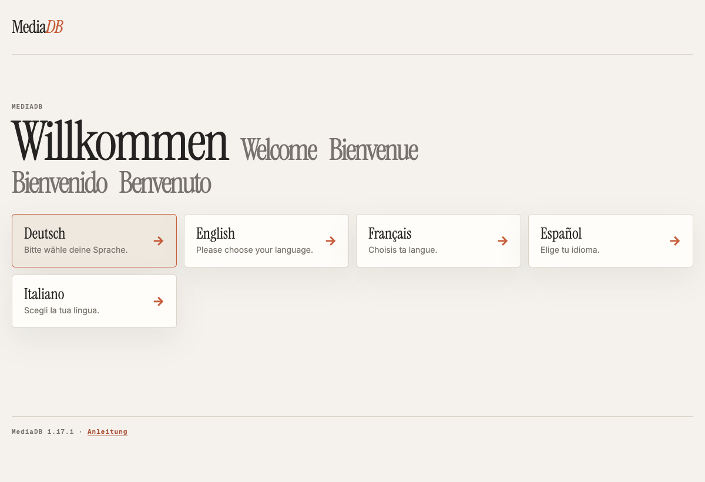

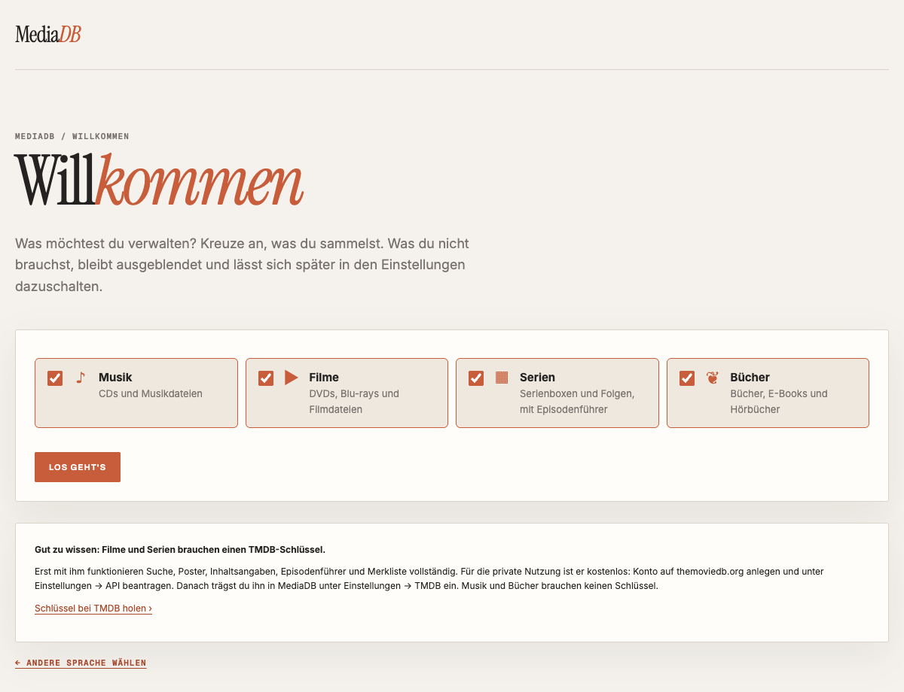

**Erste Schritte nach der Installation:** Zahnrad ⚙ oben öffnen und eintragen: deine **E-Mail-Adresse für MusicBrainz** (Pflicht für Musik), einen kostenlosen **TMDB-Schlüssel** (für Filme und Serien) und, falls vorhanden, deine **NAS-Freigaben**.

## 3. Einstellungen

Das **Zahnrad ⚙** oben öffnet die Einstellungen. Änderungen gelten sofort, ein Neustart ist nicht nötig. Gespeichert wird in `data/settings.json`; diese Werte haben Vorrang vor der Datei `.env`.

- **Sprache der Oberfläche:** links die **Hauptsprache** (Deutsch, Englisch, Französisch, Spanisch, Italienisch). Rechts hakst du an, welche Sprachen oben in der Leiste als **Umschalter** (z. B. DE · IT) erscheinen sollen, praktisch, wenn im Haushalt mehrere Sprachen gesprochen werden. Ohne Auswahl bleibt die Leiste aufgeräumt.
- **Bereiche:** Musik, Filme, Serien und Bücher lassen sich einzeln aus- und wieder einschalten. Ausgeschaltete Bereiche verschwinden aus der Leiste, der Startseite und der Suche, ihre Hintergrundarbeiten (z. B. die tägliche Serien-Aktualisierung) ruhen. **Gelöscht wird nichts:** Die Datenbank des Bereichs bleibt unberührt, nach dem Einschalten ist alles sofort wieder da. Mindestens ein Bereich bleibt an. Die Merkliste gehört zu Filmen und Serien; „Verliehen“ zeigt weiterhin alles, was verliehen ist.
- **Farben:** Hintergrund, Kästen und Eingabefelder, Schrift, Nebentext, Akzent und Links, getrennt für das helle und das dunkle Farbschema. Jede Änderung ist sofort als Vorschau zu sehen; gespeichert wird mit **„Farben speichern“**. **„Auf Ursprung zurücksetzen“** stellt die ursprünglichen Farben wieder her; sie selbst lassen sich nicht überschreiben.
- **Sprache der Daten:** In dieser Sprache kommen Titel, Inhaltsangaben, Genres und Episodennamen von TMDB in die Datenbank. Das Land bestimmt Altersfreigabe, Kinostart und Streamingdienste. Unabhängig von der Oberfläche. Wird sie später geändert, lädt **„Alles in der Datensprache neu laden“** die vorhandenen Filme und Serien im Hintergrund neu. Musik bleibt immer im Original.
- **TMDB (Filme und Serien):** der Schlüssel von themoviedb.org (Konto anlegen → Einstellungen → API → Schlüssel beantragen, Zweck privat). Mit **„TMDB-Schlüssel prüfen“** testen. Ohne Schlüssel lassen sich Filme und Serien nur von Hand anlegen; solange er fehlt oder TMDB ihn ablehnt, steht bei Filmen, Serien und Merkliste ein Hinweis mit Link zu TMDB, und hier erscheint „abgelehnt“.
- **Musik:** E-Mail-Adresse für MusicBrainz (wird nur an MusicBrainz und das Cover Art Archive geschickt) und optional ein **Discogs-Token** (discogs.com → Einstellungen → Entwickler), der die Discogs-Suche freischaltet.
- **Dienste und Automatik** (alles abschaltbar): Barcodes von DVDs und Blu-rays bei UPCitemdb nachschlagen · fehlende CD-Cover bei iTunes und Deezer suchen · Serien und Merkliste einmal am Tag aktualisieren · in den Mediatheken suchen · alle sechs Stunden bei GitHub nach einer neuen Version sehen.
- **NAS-Freigaben:** siehe Abschnitt 12.
- **Neue Version?** zeigt, welche Version läuft, welche die neueste ist und wann zuletzt nachgesehen wurde; mit **„Jetzt nach neuer Version suchen“** sofort prüfen.
- **Nutzer und Anmeldung:** für mehrere Personen im Haushalt. Zuerst legst du dich selbst als **Verwalter** an (mit Passwort) und wählst, wie man sich anmeldet; danach bist du gleich angemeldet. Weitere Personen fügst du als **Mitglied** (alles ansehen, hinzufügen, bearbeiten) oder **Gast** (nur ansehen) hinzu. Die Einstellungen sieht nur ein Verwalter. Zwei Arten der Anmeldung:
  - **Profilwahl:** Beim Öffnen auf den eigenen Namen klicken, eine PIN ist freiwillig (Verwalter brauchen immer eine). Bequem im Heimnetz.
  - **Name und Passwort:** richtige Anmeldung, 30 Tage gültig; jeder braucht ein Passwort.
  
  Oben in der Leiste steht, wer angemeldet ist; ein Klick darauf wechselt das Profil bzw. meldet ab. **„Aus“** schaltet die Konten wieder ab, die Nutzer bleiben gespeichert. Die Sammlung ist für alle dieselbe; Besitzer pro Exemplar und „gesehen“ pro Person folgen in den nächsten Versionen (Plan: `docs/KONZEPT_NUTZER.md`).

  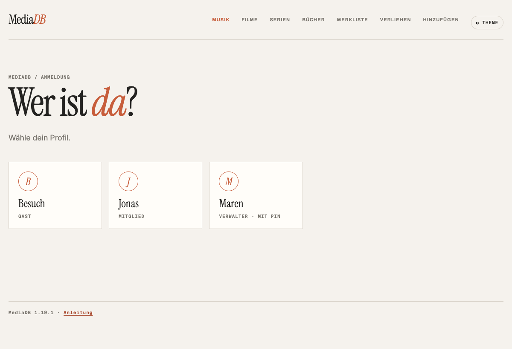

  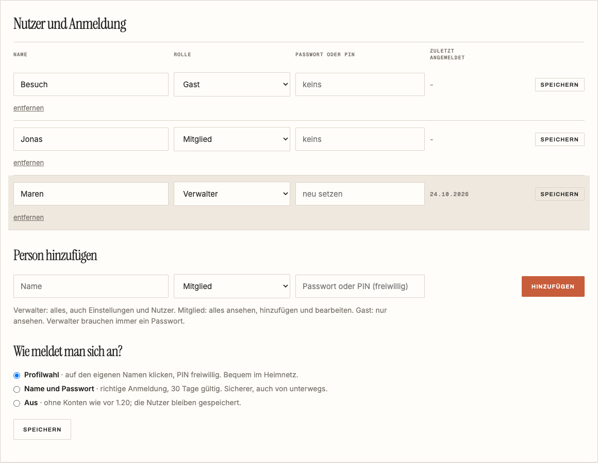
- **Zugriff:** Passwort und Zugriff aus dem Internet stehen hier nur zur Ansicht. Ändern lassen sie sich aus Sicherheitsgründen nur in der Compose-Datei (im Homelab: Stack in Dockhand) bzw. in `.env`, danach neu starten. Siehe [BETRIEB.md → Zugriffsschutz](BETRIEB.md#zugriffsschutz).

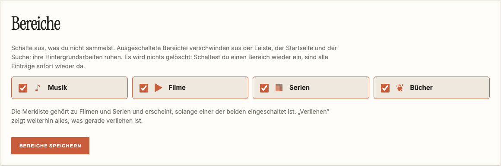

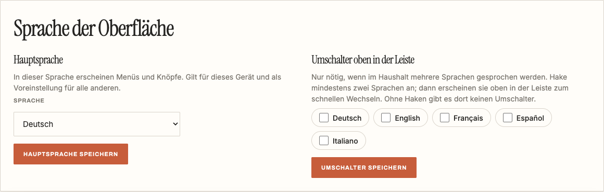

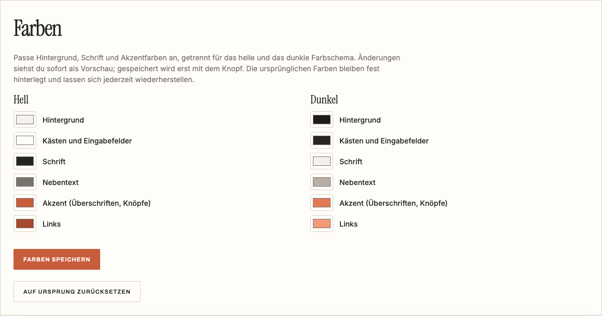

**Einträge in `.env` bzw. in der Compose-Datei** (nur nötig für den Zugriffsschutz oder eine automatische Einrichtung; alles andere geht in der App):

| Eintrag | Bedeutung |
|---|---|
| `APP_PASSWORD` | Ein gemeinsames Passwort für die Anmeldung; leer = keine Anmeldung. Sind Konten eingeschaltet (oben), gelten diese stattdessen. |
| `ALLOW_PUBLIC` | `0` (Standard): nur Heimnetz. `1` erlaubt Zugriffe aus dem Internet (nicht empfohlen). |
| `BASE_PATH` | Nur hinter einem Reverse Proxy mit Unteradresse, siehe [BETRIEB.md](BETRIEB.md). |
| `TZ` | Zeitzone, z. B. `Europe/Berlin`. |
| `MB_CONTACT` / `MB_USER_AGENT` | E-Mail für MusicBrainz (sonst in der App). |
| `TMDB_API_KEY`, `TMDB_LANGUAGE`, `DISCOGS_TOKEN` | wie in der App |
| `BARCODE_LOOKUP`, `COVER_WEB`, `AUTO_UPDATE`, `MEDIATHEK`, `UPDATE_CHECK` | `1` = an (Standard), `0` = aus; wie die Schalter unter „Dienste und Automatik“ |

## 4. Bedienung allgemein

**Startseite** (Klick auf das Logo „MediaDB“): oben die **Suche** über alle Bereiche und vier Kacheln für Musik, Filme, Serien und Bücher mit ihren Zahlen. Darunter drei Reihen, in denen alle Bereiche gemischt sind (ein kleines Schild zeigt, ob CD, Film, Serie oder Buch):
- **Als Nächstes:** was du dir vorgemerkt hast, in der Reihenfolge des Vormerkens.
- **Gerade dabei:** angefangene Serien und Bücher, die du gerade liest.
- **Zuletzt hinzugefügt.**

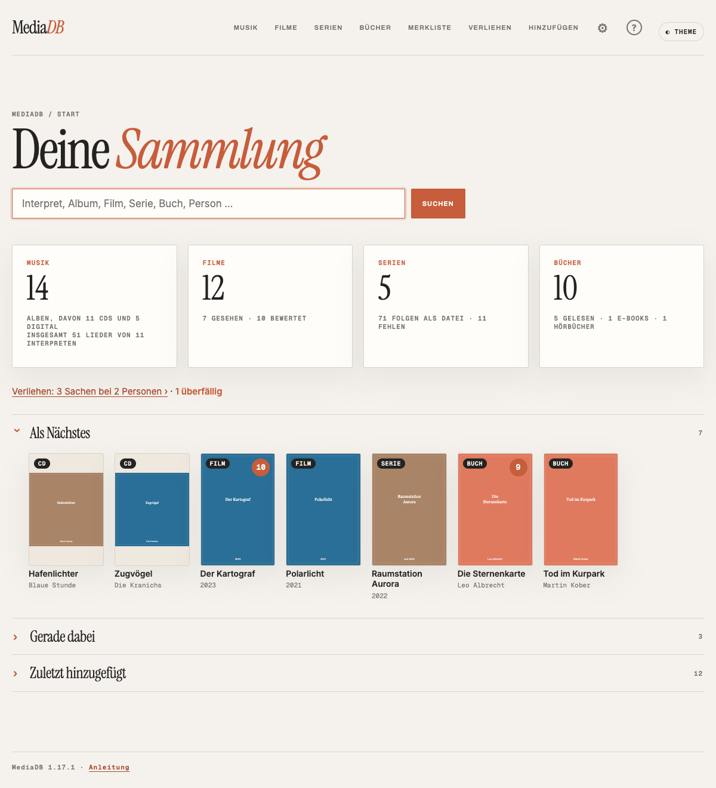

**Suche:** Das Suchfeld auf der Startseite findet Musik (auch Songtitel), Filme, Serien, Bücher, Personen und Autoren und auch Namen bei „Verliehen an“. Jeder Bereich hat zusätzlich eine eigene Suche mit Filtern.

**Als Nächstes:** Auf jeder CD-, Film-, Serien- und Buchseite gibt es **„☆ Als Nächstes vormerken“** für das, was du als Nächstes hören, sehen oder lesen möchtest; ein zweiter Klick nimmt es wieder herunter. Jeder Bereich hat dafür einen eigenen Reiter „Als Nächstes“, und ein ★ markiert vorgemerkte Einträge in allen Listen. Die Liste räumt sich selbst auf: Ein Film verschwindet, sobald er als gesehen markiert ist, ein Buch, sobald es gelesen ist, eine Serie, sobald keine ausgestrahlte Folge mehr offen ist. CDs nimmst du selbst herunter.

**Kacheln, Liste oder Text:** Oben rechts über jeder Liste wählst du die Ansicht: **Kacheln** (Cover-Raster), **Liste** (eine schmale Zeile pro Eintrag mit kleinem Bild, so passt viel mehr auf die Seite) oder **Text** (ganz ohne Bilder). Der Browser merkt sich die Wahl für jeden Bereich.

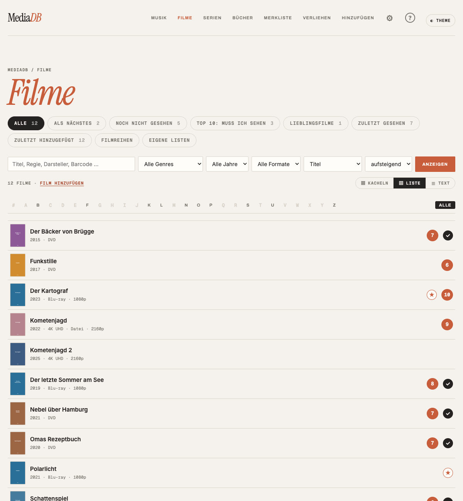

**Hintergrundaufgaben:** Läuft etwas im Hintergrund (Import, Cover laden, Aktualisierung), steht oben in der Leiste „1 Aufgabe läuft“ mit einem Punkt. Ein Klick zeigt, was genau läuft, mit Fortschritt. **Orange** heißt: liest gerade deine Dateien, **grün**: lädt nur Daten aus dem Internet. Du kannst währenddessen weiterarbeiten.

**Probelauf vor dem Speichern:** Alle Importe (Tabellen, Ordner, ISBN-Listen) zeigen erst eine **Vorschau** mit den Gruppen „Erkannt“, „Bitte prüfen“, „Nicht gefunden“ und „Schon vorhanden“. Gespeichert wird erst mit **Übernehmen**. Die Knöpfe stehen in einer Leiste, die beim Blättern unten stehen bleibt, z. B. „Bei ‚Bitte prüfen‘: überall den ersten Vorschlag“. Erneut einlesen ist gefahrlos: Schon erfasste Dateien werden übersprungen.

**Neue Version:** Gibt es eine neue Version, steht unten neben der Versionsnummer „Neue Version … verfügbar“ mit Link zu den Neuerungen. Wie man sie einspielt, steht in Abschnitt 13.

## 5. Musik

**Erfassen** (Hinzufügen):
- **Barcode:** Scanner oder Eingabe. Bei MusicBrainz werden die passenden Ausgaben gesucht (offizielle zuerst, dann die älteste; Bootlegs eingeklappt). Unvollständige Barcodes (10/11 Ziffern) werden ergänzt, Striche und Leerzeichen ignoriert. Treffer wählen → „Diesen Treffer speichern“. Cover und Titel kommen mit.
- **Diskografie-Suche ohne Scanner:** Interpret wählen, dann alle seine CDs als Liste (mit A–Z-Leiste und Barcode), Ausgabe wählen, „Das ist meine CD“.
- **Tabelle importieren (Excel, ODS, CSV):** Datei hochladen → Spalten prüfen (Interpret, Titel, Barcode, Jahr) → Abgleichen. Interpret und Albumtitel genügen, den Rest holt die App von MusicBrainz (etwa eine Zeile pro Sekunde). Vorhandenes wird übersprungen, nicht Gefundenes als einfacher Eintrag angelegt.
- **Audio-Import:** Musikordner wählen → Einlesen. Der Ordner kann auf einer externen Platte, auf der NAS oder auf dem Mac liegen (Abschnitt 12). Regeln:
  - Ein Ordner ist ein Album; mehrere Formate desselben Albums (MP3 + M4A) bleiben ein Eintrag; Disc-Ordner werden zusammengefasst.
  - Abgleich über die **Titelliste**: gleiche Titel = dieselbe CD (dann wird nur „+ digital“ und das Format vermerkt); abweichende Titel (Remaster mit Bonus) = eigener Eintrag.
  - Sampler erkennt die App daran, dass die Titel von verschiedenen Interpreten sind.
- **Von Hand:** alle Felder frei eintragbar, auch die Titelliste.

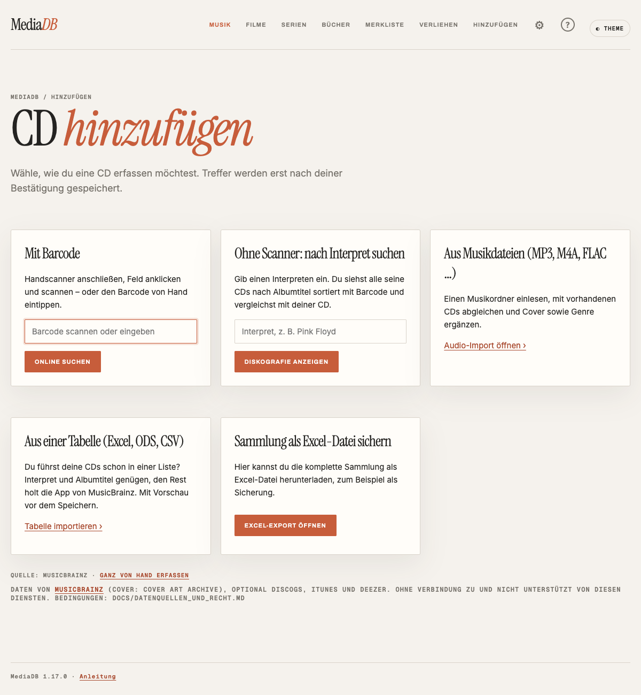

**Ansehen:** Unter **Musik** stehen die **Interpreten** mit A–Z-Leiste (ein Klick zeigt ihre CDs, bei nur einem Eintrag direkt diesen) und der Reiter **Alle CDs**. Je Eintrag: Cover, Titelliste mit Laufzeiten, Label, Katalognummer, Land, Jahr der CD **und** Erscheinungsdatum des Albums, Genre und Styles, **Besitz** (CD, nur digital, CD + digital) und Dateiformate. **Compilations** sind ein Eintrag („Various Artists“) und werden auch über die Interpreten der einzelnen Titel gefunden. Die Suche findet Künstler, Album, Genre, Label, Songtitel und Notizen; mehrere Wörter müssen alle passen.

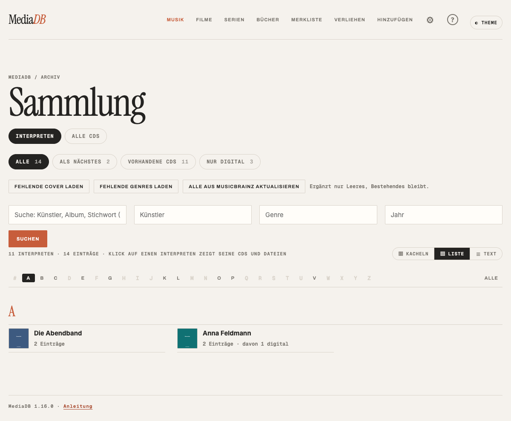

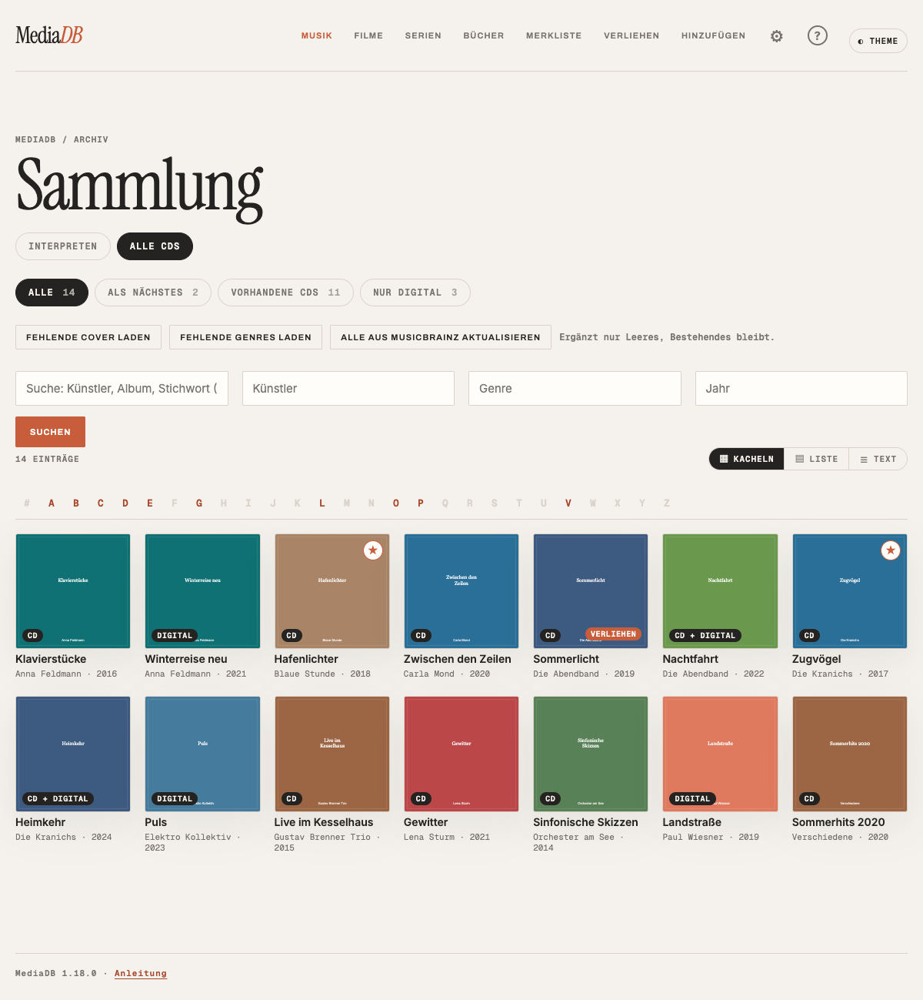

**Sammelaktionen** mit Fortschrittsanzeige: **Fehlende Cover laden**, **Fehlende Genres laden**, **Alle aus MusicBrainz aktualisieren** (füllt nur Leeres, überschreibt nichts).

**Cover oder Daten fehlen:** Eintrag öffnen → **„Ähnliche Ausgabe suchen“** → Treffer wählen, oder den Link einer **Discogs**-Release-Seite einfügen (Vorschau, dann bestätigen; übernommen werden leere Felder, Titelliste und Cover). Als letzte Möglichkeit eine Datei `cover.jpg` in den Musikordner legen.

## 6. Filme

**Voraussetzung:** ein TMDB-Schlüssel (Einstellungen, Abschnitt 3).

**Hinzufügen** (Filme → Hinzufügen):
- **Barcode:** scannen, Format wählen oder automatisch erkennen lassen. Die App fragt den Produktnamen ab („Der Pate [Blu-ray] Steelbook“ wird zu „Der Pate“) und zeigt die passenden Filme von TMDB. Treffer wählen, ggf. Fassung eintragen (Liste mit Vorschlägen wie Director’s Cut oder Steelbook, freie Eingabe geht auch), „Das ist mein Film“. Steht der Barcode schon in der Sammlung, sucht die App nicht, sondern zeigt deutlich **„Schon im Archiv“** mit „Zum Film“ und „Trotzdem neu suchen“. Auch Treffer, die es schon gibt, sind markiert. Nach dem Speichern führt **„Weiteren Film hinzufügen“** direkt zum nächsten.
- **Titelsuche:** Titel und optional Jahr.
- **Ordner-Import:** Ordner wählen → Einlesen und erkennen → Vorschau prüfen → Übernehmen. Am sichersten sind Jellyfin-/Kodi-`.nfo`-Dateien oder Namen wie `Titel (Jahr)/Titel (Jahr).mkv` bzw. `Titel (Jahr) [tmdbid-123]`. Szene-Namen wie `Titel.2010.German.1080p.BluRay` werden bereinigt. Trailer, Samples und Extras werden übersprungen, DVD-/Blu-ray-Ordner (VIDEO_TS, BDMV) zählen als ein Film. Aus den Dateien liest die App Auflösung, HDR, Codec, Laufzeit, Tonspuren und Untertitel. **Bessere Auflösung:** Gibt es den Film schon als Datei in einer anderen Auflösung, zeigt die Vorschau beide und fragt: neue Datei nehmen und den Eintrag der alten entfernen, beide behalten oder überspringen. Ist die neue besser (z. B. 2160p statt 1080p) oder die alte nicht mehr da, ist „neue nehmen“ vorgewählt. Die alte Datei selbst löscht MediaDB nie; das machst du auf dem NAS. Bei Serien geht das genauso, Folge für Folge.
- **Von Hand:** für Filme, die TMDB nicht kennt.

**Ein Film, mehrere Exemplare:** Hast du „Alien“ als DVD, Blu-ray und Datei, ist das ein Film mit drei Exemplaren. Ein weiteres Exemplar fügst du auf der Filmseite hinzu oder per Barcode-Scan des zweiten Datenträgers.

**Gesehen und Bewertung:** „Heute gesehen“ oder ein Datum eintragen; es reicht auch das Jahr (z. B. 1999). Leer heißt „unbekannt“. „Heute nochmal gesehen“ zählt hoch. Die eigene Bewertung reicht von 1 (5× löschen) bis 10 (Unbedingt sehen); bei ungesehenen Filmen heißt sie, wie dringend du ihn sehen willst.

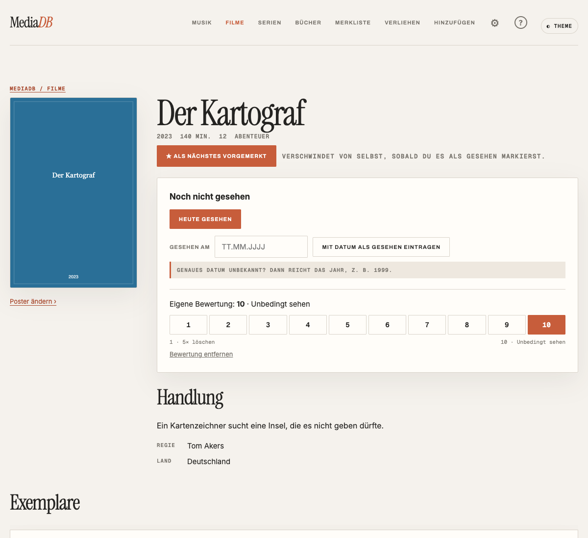

**Listen:** Alle · Als Nächstes · Noch nicht gesehen · Top 10: Muss ich sehen (die 10 ungesehenen mit der höchsten Bewertung) · Lieblingsfilme (gesehen, 9–10) · Zuletzt gesehen · Zuletzt hinzugefügt · Filmreihen (von TMDB) · Eigene Listen (anlegen unter „Eigene Listen“ oder auf der Filmseite). Die Suche findet Titel, Originaltitel, Regie, Darsteller, Stichworte und Barcodes; dazu Filter nach Genre, Jahrzehnt und Format und eine A–Z-Leiste („Der Pate“ steht unter P).

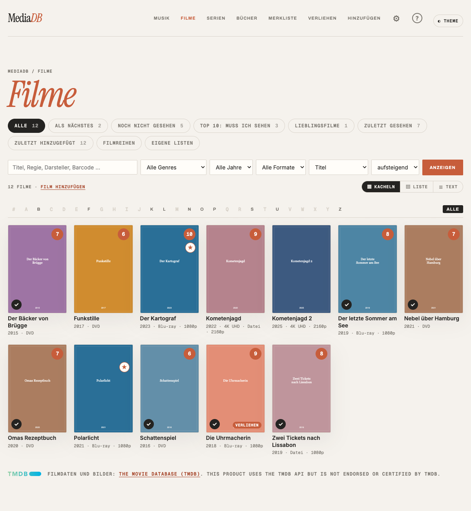

**Poster:** In der Filmübersicht **„Fehlende Poster laden“**. Die App sucht zuerst Bilder neben der Filmdatei (`poster.jpg`, `folder.jpg`, `cover.jpg` …), dann in der Datei eingebettete Cover, dann alle Poster bei TMDB. Für einen einzelnen Film: auf der Filmseite **„Poster ändern“** (TMDB-Poster wählen oder eigenes Bild hochladen, etwa einen Scan der Hülle).

**Personen:** Namen in Besetzung, Regie und Drehbuch sind anklickbar. Die Personenseite zeigt Foto und Kurzbiografie, alle Filme und Serien mit dieser Person in deiner Sammlung und darunter weitere laut TMDB, jeweils mit „Hinzufügen“.

**Falscher Treffer?** Auf der Filmseite **„Anderen Film zuordnen“**. Exemplare, gesehen, Bewertung, Listen und Notiz bleiben erhalten. Zeigt ein Film ein völlig falsches Poster, ist er meist falsch zugeordnet.

## 7. Serien

**Voraussetzung:** derselbe TMDB-Schlüssel wie für die Filme.

**Hinzufügen** (Serien → Hinzufügen):
- **Barcode einer Box:** Die App sucht über den Produktnamen. Steht darin z. B. „Staffel 1-3“ oder „Die komplette Serie“, wird das als Inhalt der Box vorgeschlagen.
- **Titelsuche:** Titel und optional das Jahr der ersten Ausstrahlung. Eine Box anzugeben ist freiwillig.
- **Ordner-Import:** den Ordner wählen, in dem die Serienordner liegen → Einlesen und erkennen → Vorschau prüfen → Übernehmen. Die Folgen werden nach Serie gruppiert, jede Serie wird einmal bei TMDB gesucht. Erkannt werden `Serie.S01E01`, `S01E02E03` (Doppelfolge), `1x01`, `E01` ohne Staffel und Staffelordner wie `Season 1` oder `Staffel 1`. Eine `tvshow.nfo` von Jellyfin oder Kodi macht die Zuordnung sicher. Neue Folgen kommen beim nächsten Lauf einfach dazu.
- **Von Hand:** für Serien, die TMDB nicht kennt (dann ohne Episodenführer).

**Episodenführer:** Für jede Serie lädt die App alle Staffeln und Folgen mit Titel, Inhalt und Ausstrahlungsdatum. Die Folgennamen kommen von dort, auch wenn der Dateiname keinen enthält; fehlt ein Titel in der Datensprache, wird der englische genommen. **„Episodenführer aktualisieren“** holt neue Folgen.

**Was fehlt?** Auf der Serienseite steht bei jeder Folge „vorhanden“ (mit Auflösung oder „Box“), „fehlt“ oder „kommt“. Die Seite **Was fehlt?** listet alle Serien mit Lücken, auch **als Text zum Kopieren**. Gezählt werden nur ausgestrahlte Folgen, Specials (Staffel 0) nicht.

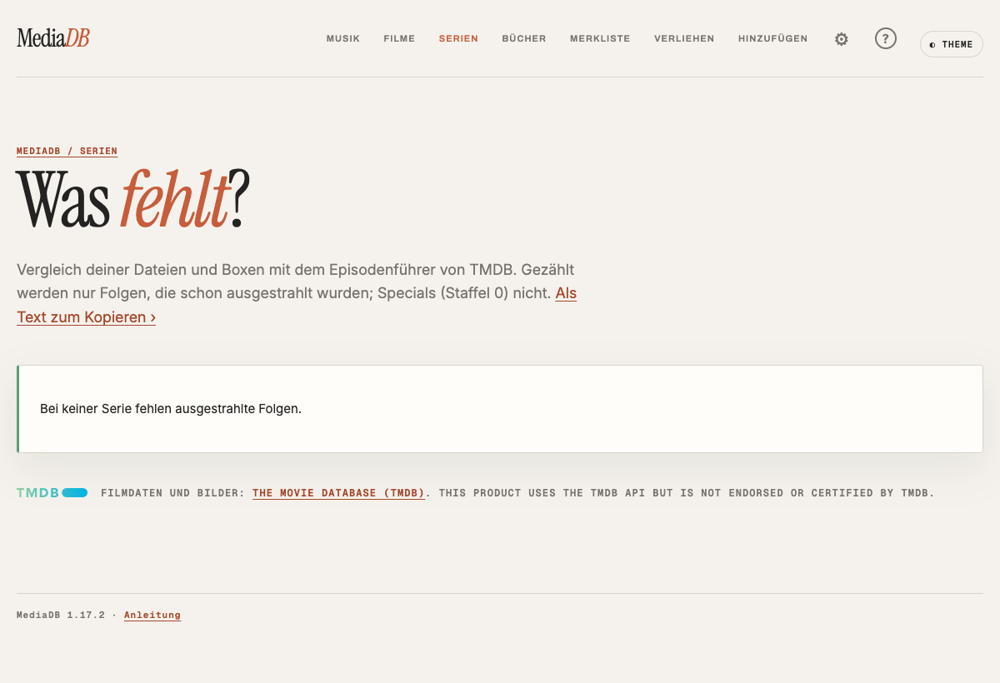

**Gesehen und Bewertung:** pro Folge ein Haken, „Ganze Staffel als gesehen“ oder oben bei **„Weiter mit:“** (der nächsten ungesehenen Folge) auf „Gesehen“. Die Bewertung 1–10 gilt wie bei den Filmen.

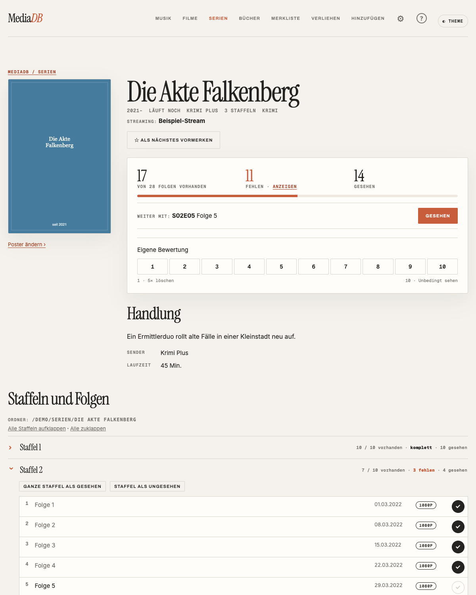

**Übersicht:** Alle · Als Nächstes · Unvollständig · Angefangen · Noch nicht angefangen · Ganz gesehen · Läuft noch · Zuletzt hinzugefügt · Was fehlt?, dazu ein Filter nach Streamingdienst. Die Suche findet Titel, Darsteller, Sender und Barcodes.

**Streamingdienst:** Auf der Serienseite steht, bei welchem Dienst die Serie im Abo läuft (laut JustWatch über TMDB), mit „Wo ansehen?“ und dem Termin der nächsten Folge. Stimmt das nicht, unter „Bearbeiten“ einen eigenen eintragen.

**Korrigieren:** Dateien, die keiner Folge zugeordnet werden konnten, stehen unten auf der Serienseite; dort Staffel und Folge von Hand eintragen. Falsche Serie erkannt: **„Andere Serie zuordnen“** (Dateien, Boxen und gesehen bleiben).

## 8. Merkliste

Menü **Merkliste**:
- **Neu bei deinen Serien:** was demnächst startet (z. B. „Staffel 4 startet am 16.10.“ mit Dienst), was in den letzten 30 Tagen erschienen ist und welche Staffeln angekündigt sind.
- **Vorgemerkt:** Filme und Serien suchen, **„Vormerken“**, eine Notiz dazuschreiben (etwa „Tipp von …“). Die App zeigt Kinostart, Digitalstart oder Staffelstart, den Streamingdienst und ob der Titel schon in der Sammlung ist. „In die Sammlung“ führt zum passenden Bereich, „erledigt“ nimmt den Eintrag herunter (wiederherstellbar unter „Erledigte Einträge“).
- **Jetzt in der Mediathek:** vorgemerkte Titel, die gerade bei ARD, ZDF & Co. abrufbar sind.

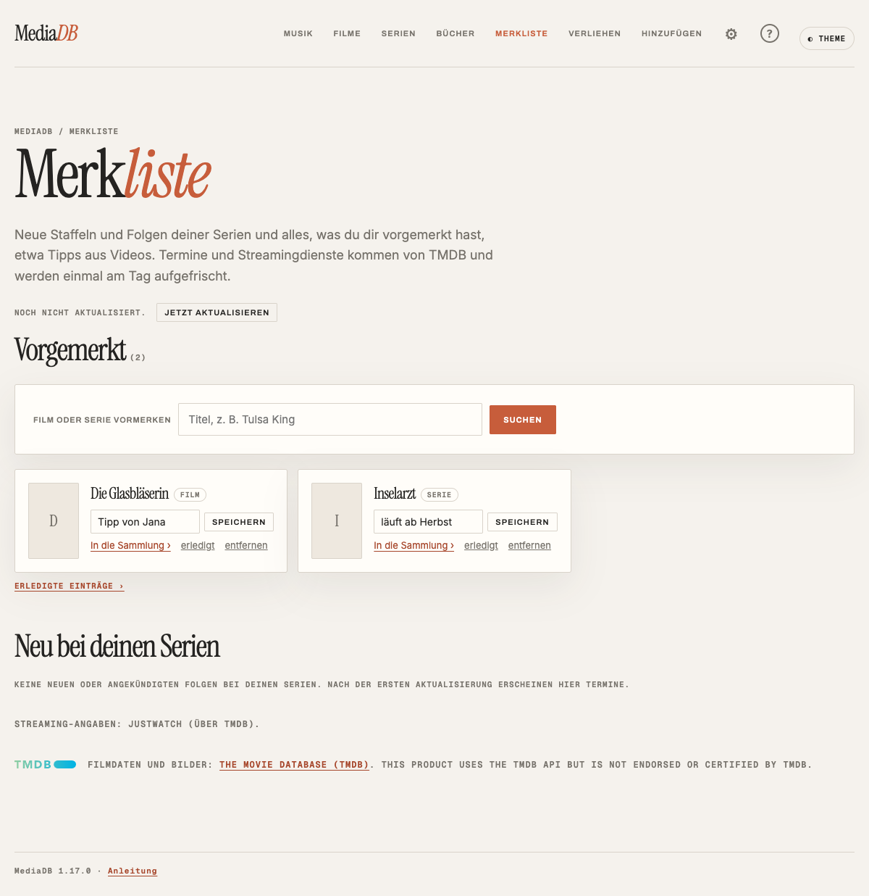

**Aktualisierung:** Einmal am Tag frischt die App im Hintergrund auf: laufende Serien täglich, beendete alle 30 Tage, dazu die Merkliste. **„Jetzt aktualisieren“** startet es sofort.

Merkliste oder Als Nächstes? Die **Merkliste** ist für Titel, die du noch **nicht** hast. **Als Nächstes** (Abschnitt 4) ist für Einträge aus deiner Sammlung.

## 9. Bücher

Ein Schlüssel ist nicht nötig.

**Hinzufügen** (Bücher → Hinzufügen):
- **Mit ISBN:** den Strichcode scannen oder die ISBN eintippen (10 oder 13 Stellen). Die App fragt die **Deutsche Nationalbibliothek** und **Open Library** und zeigt die Ausgabe zur Bestätigung. Ist die ISBN schon in der Sammlung, zeigt sie das vorhandene Buch.
- **Nach Titel und Autor:** Titel und am besten den Nachnamen eingeben, dann die richtige Ausgabe wählen.
- **Von Hand:** für Bücher, die keine Datenbank kennt.
- **Viele Bücher auf einmal** (Bücher-Import): eine **ISBN-Liste** (eine ISBN pro Zeile, z. B. nacheinander in eine Textdatei gescannt) oder eine **CSV- oder Excel-Tabelle** mit Spalten wie ISBN, Titel, Autor, Format, Gelesen, Bewertung, Notiz. Etwa eine Sekunde pro Buch; die Statusanzeige oben zeigt den Fortschritt.
- **E-Books und Hörbücher aus Ordnern:** EPUB, PDF, MOBI/AZW3, Calibre-Bibliotheken (Angaben aus `metadata.opf`), M4B-Dateien und Ordner mit MP3/M4A (ein Ordner = ein Hörbuch, auch mit Unterordnern „CD 1“, „CD 2“). Für Hörbücher nur den Hörbuch-Ordner wählen, nicht die Musiksammlung.

**Exemplare:** gebunden, Taschenbuch, E-Book, Hörbuch oder anderes; ein Buch kann mehrere haben.

**Lesen und Bewerten:** „Lese ich gerade“, „Gelesen“ mit Datum (oder nur dem Jahr), Bewertung 1–10, Notiz.

**Übersicht:** sortierbar nach Autor (Nachname), Titel (ohne „Der/Die/Das“), Jahr, Bewertung und Hinzufügedatum, mit A–Z-Leiste und Filtern für Genre, Format und Sprache. Ansichten: Als Nächstes, Ungelesen, Lese ich gerade, Gelesen, Lieblinge, Zuletzt gelesen, Zuletzt hinzugefügt, E-Books, Hörbücher.

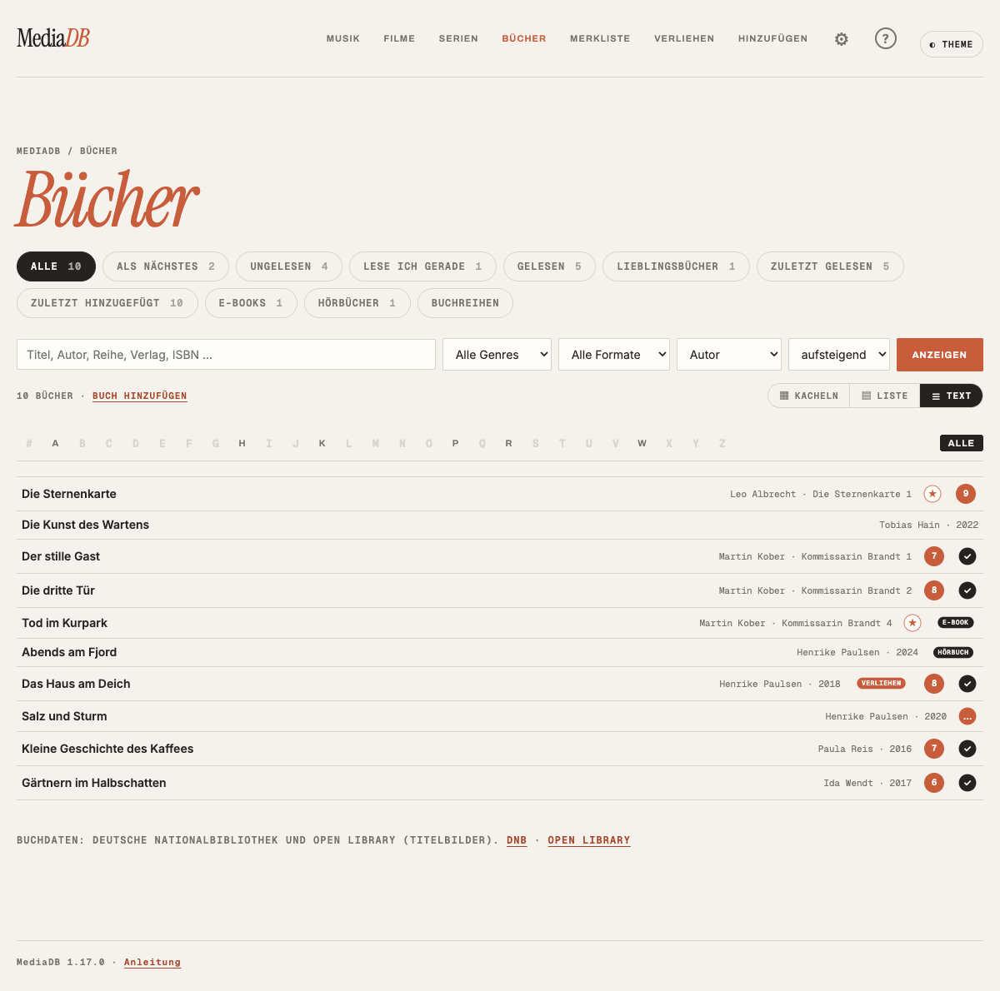

**Autoren und Reihen:** Autorennamen sind anklickbar. Unter **Buchreihen** stehen alle Reihen mit Bandnummern; fehlende Bände werden genannt.

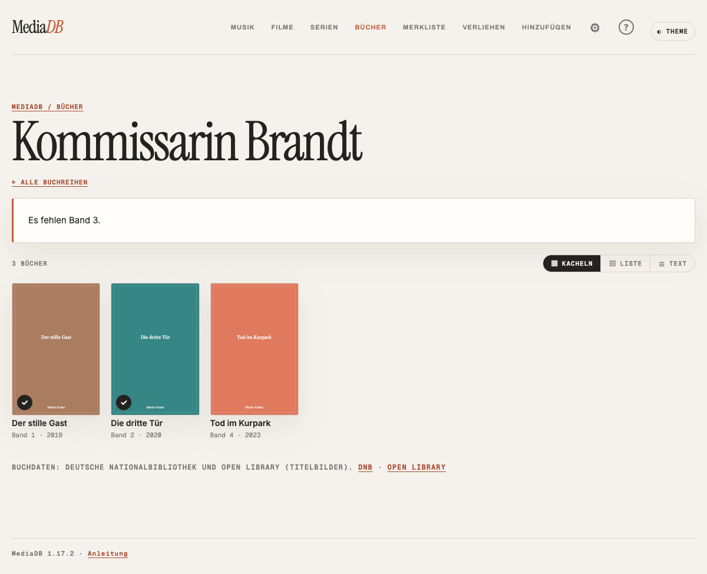

**Zusammenfassung und Bewertungen:** Unter „Inhalt“ der Verlagstext (über die Nationalbibliothek) oder die Beschreibung von Open Library, darunter die Einleitung des **Wikipedia**-Artikels, falls es einen gibt, und die **Bewertung bei Open Library**. „Rezensionen suchen“ öffnet eine Suche bei Perlentaucher, Goodreads oder im Web. Passt der Wikipedia-Artikel nicht, „Entfernen“ klicken.

**Korrigieren:** „Bearbeiten“ für alle Angaben, „Leere Felder ergänzen“ (überschreibt nichts), „Anderes Buch zuordnen“ bei falschem Treffer, „Titelbild ändern“ für ein anderes Cover oder ein eigenes Foto.

**Gut zu wissen:** Bei der Nationalbibliothek ist die Reihe oft nur die Verlagsreihe („dtv 21412“); solche Angaben übernimmt die App nicht, die Reihe kannst du unter „Bearbeiten“ selbst eintragen. Cover gibt es nicht für jede deutsche Ausgabe; dann hilft ein Foto des Umschlags.

## 10. Verliehen an …

Für alle Bereiche gemeinsam gibt es die Seite **Verliehen** (Menü), mit eigener kleiner Datenbank (`data/verleih.db`).

**Was sich verleihen lässt:** nur, was du in der Hand hast: CDs (Besitz „CD“ oder „CD + digital“), DVDs, Blu-rays und 4K-Discs, Serien-Boxen, gedruckte Bücher und Hörbuch-CDs. Bei Dateien und E-Books steht „Nur digital vorhanden“.

**Verleihen:** Unten auf der CD-, Film-, Serien- oder Buchseite „Verleihen …“ öffnen, den Namen eintragen (bekannte Namen werden vorgeschlagen), Datum prüfen (heute vorbelegt; leer lassen oder nur das Jahr, wenn du es nicht mehr weißt) und „Als verliehen eintragen“. „Zurück bis“ und Notiz sind freiwillig. Bei mehreren Exemplaren wählst du, welches.

**Viele alte Verleihungen nachtragen:** Auf der Seite „Verliehen“ oben den Namen eintragen und nach Titel, Interpret oder Autor suchen. Bei jedem Treffer steht „An … verleihen“.

**Zurückbekommen:** auf der Detailseite, in der Übersicht oder auf der Seite der Person; dort auch „Alles zurückbekommen“. Ein versehentlicher Eintrag lässt sich löschen.

**Überblick:** alles nach Personen sortiert, mit Filter nach Bereich; überfällige Rückgaben sind rot. **„Als Text zum Kopieren“** liefert die Liste, etwa für eine Nachricht. Verliehene Einträge sind in allen Übersichten markiert.

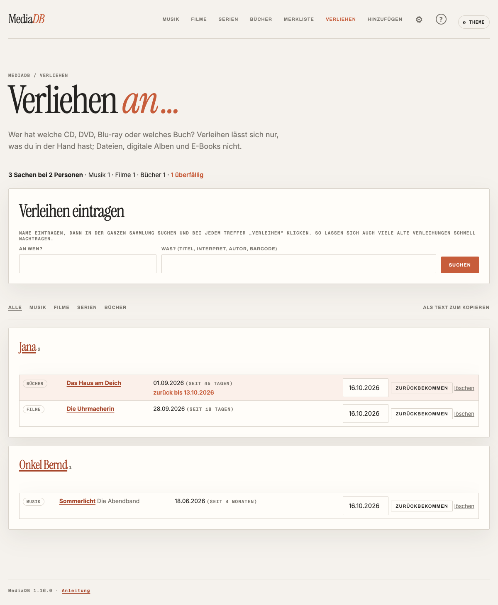

## 11. Mediatheken

Auf jeder Serien- und Filmseite steht **In der Mediathek**: Treffer aus den Mediatheken der öffentlich-rechtlichen Sender (ARD, ZDF, Arte, 3sat, ORF, SRF und weitere) mit Sender, Sendedatum, Länge und Link. Die Suche läuft nach dem Laden der Seite und dauert meist ein, zwei Sekunden.

**Bei Serien** werden die Folgen dem Episodenführer zugeordnet und mit **„fehlt dir“** oder „vorhanden“ markiert. So siehst du sofort, ob eine fehlende Folge gerade irgendwo läuft.

**Gut zu wissen:** Sendungen stehen nur begrenzte Zeit in den Mediatheken, manche nur in bestimmten Ländern. MediaDB zeigt nur Links und lädt nichts herunter. Abschaltbar unter Einstellungen → „Dienste und Automatik“.

## 12. Dateien von NAS und Mac

MediaDB liest Musik, Filme, Serien und Bücher **direkt von der NAS** (SMB, wie im Finder oder Windows-Explorer), ohne dass etwas eingehängt werden muss, auch im Proxmox-LXC. Es wird nur gelesen.

1. **Einstellungen → NAS-Freigaben → Freigabe hinzufügen:** Name (z. B. „Musik“), **IP-Adresse** der NAS (z. B. `192.168.1.20`; Namen wie `nas.local` findet der Container meist nicht), Freigabe, optional ein Unterordner, Benutzer und Passwort. Die ganze Adresse `smb://192.168.1.20/Musik/Alben` ins Feld NAS-Adresse zu kopieren geht auch.
2. **„Verbindung prüfen“** testet, ohne zu speichern, und sagt, woran es hängt (Name nicht gefunden, NAS antwortet nicht, SMB aus, Anmeldung, Freigabe oder Unterordner falsch). Dann **„Speichern und prüfen“**.
3. Für weitere Freigaben auf derselben NAS **„Zugang einer eingerichteten NAS übernehmen“** wählen.
4. Beim Einlesen erscheint die Freigabe in der Ordnerauswahl als **„NAS: Musik“**.

**NAS, die nicht immer an ist:** Neben jeder NAS steht in den Einstellungen und in der Ordnerauswahl ein Punkt: **grün „erreichbar“** oder **orange „gerade aus“**. Was eingelesen ist, bleibt in MediaDB, auch wenn die NAS aus ist. Geht sie während des Einlesens aus, nennt MediaDB danach die Ordner, die fehlen; einfach später noch einmal einlesen.

**Musik vom Mac:** Den Musikordner am Mac per Dateifreigabe (SMB) freigeben und in MediaDB wie eine NAS eintragen. Wichtig ist dabei der Haken bei **Windows-Dateifreigabe** für deinen Benutzer. Die Schritte stehen in [BETRIEB.md → Musik vom Mac](BETRIEB.md#musik-vom-mac-oder-einem-anderen-rechner-einlesen). Ein Windows-PC geht genauso.

Mehr Hilfe bei Problemen: [BETRIEB.md → Musik und Filme von der NAS einlesen](BETRIEB.md#musik-und-filme-von-der-nas-einlesen-ab-1-9).

## 13. Sichern und Updates

**Deine Daten** liegen im Ordner `data/` (im Homelab `/opt/mediadb/data`): die Datenbanken `musik.db`, `filme.db`, `serien.db`, `buecher.db` und `verleih.db`, die Einstellungen `settings.json`, die Cover und Bilder. **Diesen Ordner sichern** und bei Updates nie überschreiben. Wie man im LXC sichert, steht in [BETRIEB.md → Sicherung](BETRIEB.md#sicherung).

**Export** (Hinzufügen bei der Musik → „Excel-Export öffnen“): xlsx (Excel), ods (LibreOffice), csv (Semikolon, UTF-8) oder Markdown; alles, nur CDs oder nur Digitales. Die Excel-Datei enthält alle Felder samt Titellisten und lässt sich wieder importieren. Der Export umfasst nur die Musik; für eine vollständige Sicherung immer den Ordner `data` kopieren.

**Neue Version einspielen:**
- **Homelab mit Dockhand:** Stack „mediadb“ → **Pull** → **Redeploy**. Die Daten bleiben erhalten.
- **Mac mit dem Projektordner:** neue Dateien über das Projekt kopieren (`data/` und `.env` nicht anfassen), dann `docker compose up --build -d` und im Browser Cmd+Shift+R.

Danach steht unten die neue Versionsnummer. Was sich geändert hat, steht in [CHANGELOG.md](../CHANGELOG.md) und bei den [Releases auf GitHub](https://github.com/luro611/mediadb/releases).

## 14. Woher kommen die Daten?

Musik: **MusicBrainz** mit dem **Cover Art Archive**, optional **Discogs**, als Cover-Ausweichquelle **iTunes** und **Deezer**, dazu die Tags in deinen Musikdateien. Filme und Serien: **TMDB** (Daten, Episodenführer, Bilder; Streamingdienste von JustWatch über TMDB), DVD-/Blu-ray-Barcodes: **UPCitemdb**. Bücher: **Deutsche Nationalbibliothek**, **Open Library** und **Wikipedia**. Mediatheken: **MediathekViewWeb**. Neue Versionen: die öffentliche Release-Liste auf **GitHub**. Es werden nur Suchbegriffe gesendet, deine Sammlung bleibt bei dir. Genaueres, auch zur Frage „Darf ich das?“, steht in [DATENQUELLEN_UND_RECHT.md](DATENQUELLEN_UND_RECHT.md).

## 15. Grenzen

- Keine getrennten Konten: ein gemeinsames Passwort (optional); „gesehen“, „gelesen“ und Bewertungen gelten für den ganzen Haushalt. Nicht ins offene Internet stellen.
- Barcodes von DVDs und Blu-rays kennt der freie Dienst bei deutschen Ausgaben nur lückenhaft. Dann hilft die Titelsuche; der Barcode wird trotzdem gespeichert.
- Gelöschte oder verschobene Dateien werden nicht automatisch bereinigt.
- NAS und Mac: nur SMB2/SMB3 mit Benutzer und Passwort, kein Gastzugang.
- Cover von iTunes/Deezer sind rechtlich eine Grauzone und lassen sich abschalten.
- Sehr alte, seltene oder nur lokal veröffentlichte Alben fehlen manchmal bei MusicBrainz; dann hilft Discogs oder die Handerfassung.
- Hobbyprojekt ohne Gewährleistung; Fehler bitte mit der Versionsnummer und, wenn möglich, dem Log melden.

## 16. Fehlersuche

| Problem | Lösung |
|---|---|
| Seite nicht erreichbar | Homelab: in Dockhand nachsehen, ob der Stack läuft, und die Logs des Containers ansehen. Mac: `docker compose ps`, `docker compose up -d`, notfalls `docker compose logs --tail 60`. |
| Container startet in Dauerschleife | Im Log die erste Zeile mit `Traceback` lesen und mit der Versionsnummer melden. |
| Neue Version läuft nicht, obwohl Pull und Redeploy gemacht | Unten auf der Seite die Versionsnummer prüfen; in Dockhand erneut **Pull** (nicht nur Redeploy), dann Redeploy. |
| Kein Hinweis auf eine neue Version | Einstellungen → „Neue Version?“ → „Jetzt nach neuer Version suchen“. |
| NAS: „Verbindung prüfen“ meldet einen Fehler | Die Meldung sagt, woran es liegt; darunter steht eine technische Angabe. IP statt Namen eintragen, Benutzer und Passwort prüfen. Siehe Abschnitt 12. |
| NAS steht auf „gerade aus“ | NAS einschalten und ein, zwei Minuten warten, Seite neu laden. |
| Nach dem Import: „Nicht lesbar: … Ordner“ | NAS war zwischendurch aus oder der Benutzer darf die Ordner nicht lesen. Später noch einmal einlesen. |
| Musikordner auf dem Mac leer oder „Zugriff verweigert“ | macOS-Zugriff für OrbStack/Docker erlauben (Abschnitt 2). |
| MusicBrainz antwortet nicht | Später erneut versuchen; die App hält 1 Anfrage pro Sekunde ein. E-Mail-Adresse in den Einstellungen eingetragen? |
| Filme oder Serien: „Kein TMDB-Schlüssel“ | Schlüssel unter Einstellungen eintragen und „TMDB-Schlüssel prüfen“. |
| Barcode findet nichts | Vollständigkeit prüfen (12/13 Ziffern), sonst Titelsuche bzw. „Ähnliche Ausgabe suchen“. |
| Ordner auf der NAS lässt sich nicht umbenennen | Oben nachsehen, ob eine Aufgabe „liest Dateien“ läuft (orange). Danach geht es wieder. |
| Cover nicht gefunden | Siehe Abschnitt 5, „Cover oder Daten fehlen“. |
