# MediaDB – User manual

MediaDB is a **private media database for your home network** with four sections: **music, films, TV shows and books**, plus a **watchlist**, **up next** and **lent to …**. You record CDs, DVDs, Blu-rays, books and your files (music, films, episodes, e-books, audiobooks); the app fills in track lists, covers, film data, episode guides and book details from free online sources. Everything runs in the browser, on a computer as well as on a phone. Your data stays with you.

This manual describes MediaDB 1.22.0. The running version is shown at the bottom of every page. You can also open this manual in MediaDB itself: via the **?** in the top bar or the **“Manual”** link at the bottom of every page, matching the installed version and without internet. (This is the English translation of the German manual `ANLEITUNG.md`. The pages “Running in a homelab”, “Data sources and legal” and “Changes” are only available in German so far; your browser’s translate function works well on them.)

**Contents:** [1. Overview](#1-overview) · [2. Installation](#2-installation) · [3. Settings](#3-settings) · [4. General use](#4-general-use) · [5. Music](#5-music) · [6. Films](#6-films) · [7. TV shows](#7-tv-shows) · [8. Watchlist](#8-watchlist) · [9. Books](#9-books) · [10. Lent to …](#10-lent-to) · [11. Media libraries](#11-media-libraries) · [12. Files from a NAS or Mac](#12-files-from-a-nas-or-mac) · [13. Backups and updates](#13-backups-and-updates) · [14. Where does the data come from?](#14-where-does-the-data-come-from) · [15. Limitations](#15-limitations) · [16. Troubleshooting](#16-troubleshooting)

## 1. Overview

| Section | Adding | Highlights |
|---|---|---|
| **Music** | barcode, discography search, spreadsheet, audio import, by hand | track lists and covers from MusicBrainz, files matched against the CDs you own |
| **Films** | barcode, title search, folder import, by hand | data from TMDB, several copies per film, watched, rating, your own lists, collections |
| **TV shows** | barcode of a box set, title search, folder import, by hand | episode guide, “What’s missing?”, watched per episode, streaming service |
| **Books** | ISBN, title and author, list or spreadsheet, e-books and audiobooks from folders, by hand | data from the German National Library and Open Library, authors, book series, summaries |
| **Watchlist** | note films and shows | new seasons and episodes of your shows, cinema release, streaming service |
| **Lent** | on every detail page | who has what since when |

For all sections: a shared **search**, **up next**, the views **tiles / list / text**, results from the German public broadcasters’ **media libraries** (ARD, ZDF and others), **NAS shares** for reading files directly from your NAS, and a user interface in **German, English, French, Spanish and Italian**.

## 2. Installation

**Recommended: in your homelab** (Proxmox LXC, Linux server, NAS with Docker). MediaDB then runs around the clock and everyone in the household can reach it in the browser. There is a ready-made Docker image on GitHub; the file `docker-compose.homelab.yml` can be pasted unchanged as a stack into **Dockhand** or Portainer. The step-by-step guide is in **[BETRIEB.md](BETRIEB.md)** (German: size of the LXC, setup, moving from a Mac, updates, backups, access protection).

**On a Mac (or another computer with Docker)**, e.g. to try it out. You need **Docker**, on a Mac e.g. **OrbStack** or Docker Desktop.
1. Download the project from [GitHub](https://github.com/luro611/mediadb) (*Code → Download ZIP*) and unpack it.
2. Open a terminal in the project folder.
3. `cp .env.example .env` (the file must exist; you don’t have to fill it in, you set everything important later in the app).
4. `docker compose up --build -d`
5. Open `http://localhost:8000` in the browser.

Stop: `docker compose down`. Show errors: `docker compose logs --tail 60`. On a Mac, external drives (`/Volumes`) and your home folder are mounted read-only. On first access macOS may ask for permission: *System Settings → Privacy & Security → Files and Folders* or *Full Disk Access* for OrbStack.

**On the very first start** MediaDB greets you in all five languages; your browser’s language comes first. Click your language, and everything after that appears in it. In the second step you tick what you want to manage (music, films, TV shows, books). As long as no TMDB key is entered, a note below explains that films and TV shows only work fully with this key, which is free for private use at themoviedb.org. You can change both later in the settings. If you already have data (e.g. after an update), you won’t see this page.

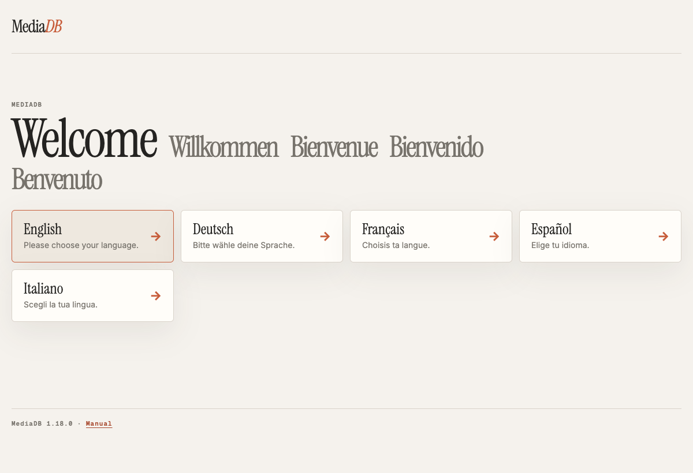

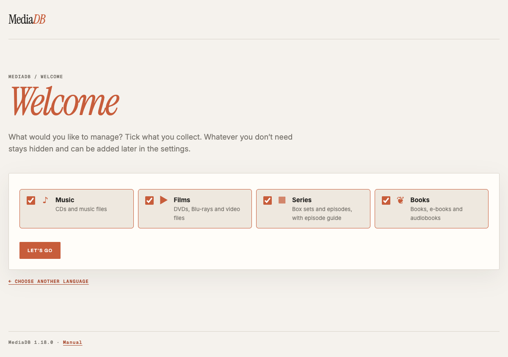

**First steps after installing:** open the gear ⚙ at the top and enter your **e-mail address for MusicBrainz** (required for music), a free **TMDB key** (for films and TV shows) and, if you have one, your **NAS shares**.

## 3. Settings

The **gear ⚙** at the top opens the settings. Changes apply immediately, no restart needed. They are saved in `data/settings.json` and take precedence over the `.env` file.

- **Interface language:** on the left the **main language** (German, English, French, Spanish, Italian). On the right you tick which languages should appear as a **switcher** in the top bar (e.g. DE · EN), handy when several languages are spoken in the household. With nothing ticked the top bar stays tidy.
- **Sections:** music, films, TV shows and books can each be switched off and on again. Switched-off sections disappear from the top bar, the home page and the search, and their background tasks (e.g. the daily TV show update) pause. **Nothing is deleted:** the section’s database stays untouched, and after switching it back on everything is there again right away. At least one section stays on. The watchlist belongs to films and TV shows; “Lent” still shows everything that is lent out.
- **Colours:** background, boxes and input fields, text, secondary text, accent and links, separately for the light and the dark colour scheme. Every change is shown immediately as a preview; **“Save colours”** stores it. **“Reset to original”** brings back the original colours; those themselves can never be overwritten.
- **Data language:** titles, plot summaries, genres and episode names come from TMDB into the database in this language. The country determines age ratings, cinema releases and streaming services. It is independent of the interface language. If you change it later, **“Reload everything in the data language”** reloads your films and TV shows in the background. Music always stays in the original.
- **TMDB (films and shows):** the key from themoviedb.org (create an account → Settings → API → request a key, purpose personal). Test it with **“Check TMDB key”**. Without a key, films and TV shows can only be added by hand; as long as it is missing or TMDB rejects it, films, shows and the watchlist show a note with a link to TMDB, and this section says “rejected”.
- **Music:** e-mail address for MusicBrainz (only sent to MusicBrainz and the Cover Art Archive) and optionally a **Discogs token** (discogs.com → Settings → Developers), which enables the Discogs search.
- **Services and automation** (all can be switched off): look up DVD and Blu-ray barcodes at UPCitemdb · look for missing CD covers on iTunes and Deezer · update shows and watchlist once a day · search the media libraries · check GitHub for a new version every six hours.
- **NAS shares:** see section 12.
- **New version?** shows which version is running, which is the latest and when it was last checked; **“Check for a new version now”** checks immediately.
- **Users and sign-in:** for several people in a household. First add yourself as **administrator** (with a password) and choose how people sign in; you are then signed in right away. Add more people as **member** (view, add and edit everything) or **guest** (view only). Only administrators see the settings. Two ways to sign in:
  - **Profile picker:** click your own name when opening MediaDB; a PIN is optional (administrators always need one). Convenient at home.
  - **Name and password:** proper sign-in, valid for 30 days; everyone needs a password.
  
  The top bar shows who is signed in; clicking it switches profile or signs out. **“Off”** turns accounts off again; the users stay saved. The collection is the same for everyone, but **each person has their own details:** watched (including single episodes), own rating, read, “Up next” and the watchlist. Lists such as “Not watched yet” or “Top 10: must watch” and the numbers on the start page apply to the person signed in. A film’s or book’s page shows who has watched or read it (“Watched by: …”), a TV show how many episodes each person has watched. Custom lists and notes stay shared. When accounts are turned on, the existing details become those of the first administrator; if accounts are turned off again, the details from before the accounts apply.

  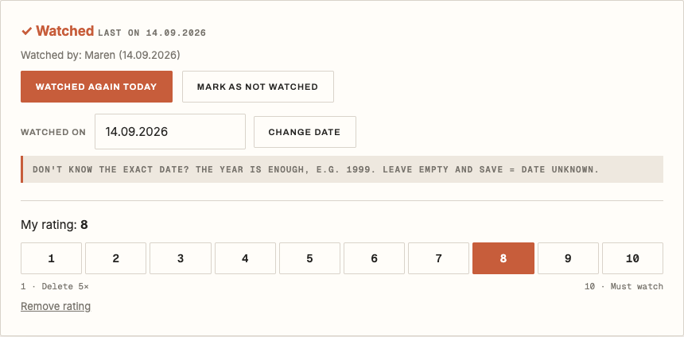

  **Owner:** with accounts, every copy (DVD, Blu-ray, file, book, TV box) and every music album has an owner. Whoever adds something becomes its owner; when accounts are turned on, the existing collection belongs to the first administrator. You can change the owner on the item’s page, also to **“Household”** (shared). The lists filter by **“All owners · Mine · Household · …’s”**; under “Lent” every entry shows whose copy it is, with the tab **“Mine lent out”**.

  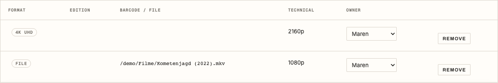

  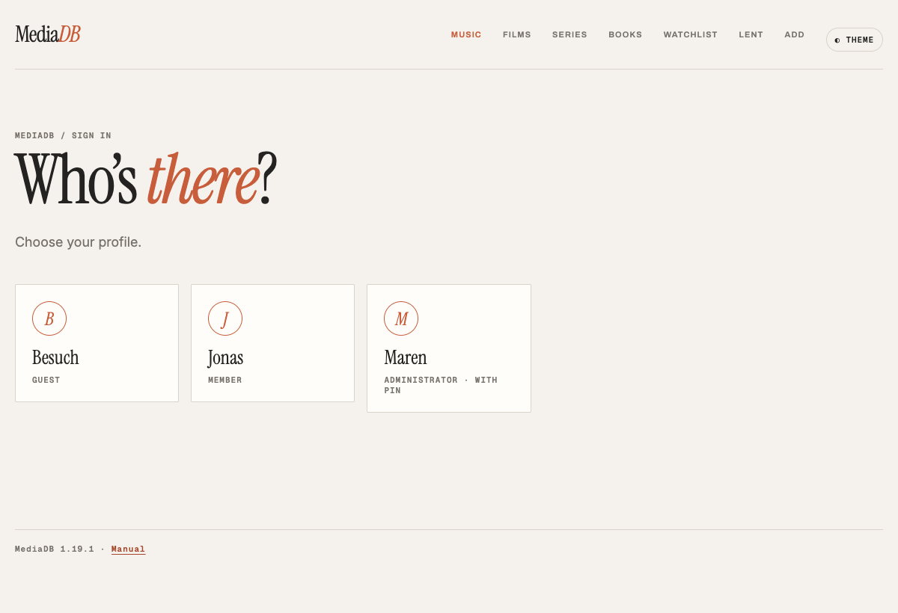

  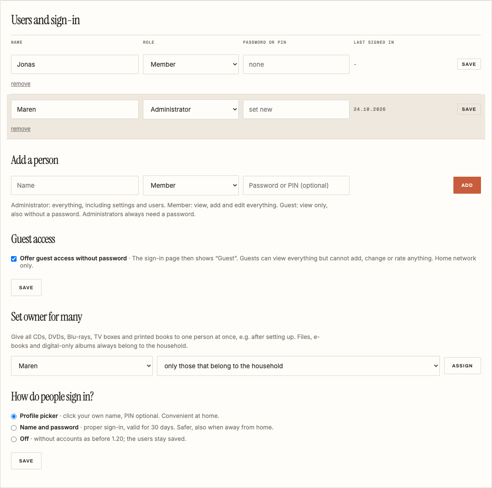
- **Access:** password and access from the internet are shown here for information only. For security reasons they can only be changed in the compose file (in a homelab: the stack in Dockhand) or in `.env`, followed by a restart. See [BETRIEB.md → Zugriffsschutz](BETRIEB.md#zugriffsschutz) (German).

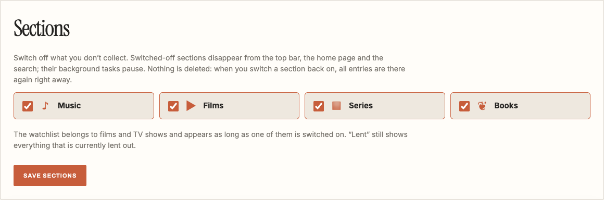

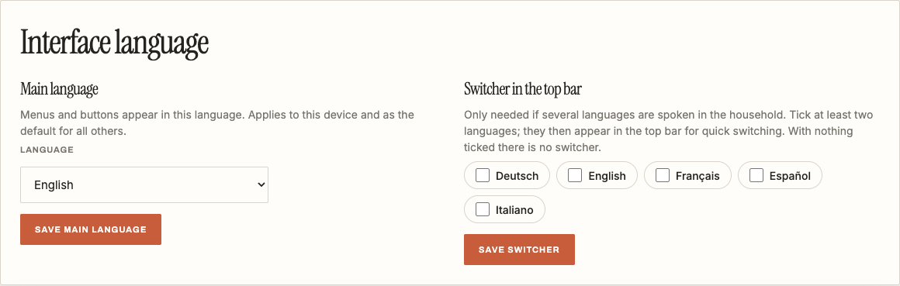

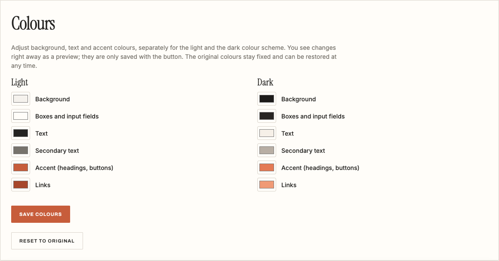

**Entries in `.env` or in the compose file** (only needed for access protection or an automated setup; everything else is done in the app):

| Entry | Meaning |
|---|---|
| `APP_PASSWORD` | one shared password for signing in; empty = no sign-in. If accounts are turned on (above), they apply instead. |
| `ALLOW_PUBLIC` | `0` (default): home network only. `1` allows access from the internet (not recommended). |
| `BASE_PATH` | only behind a reverse proxy with a sub-path, see [BETRIEB.md](BETRIEB.md). |
| `TZ` | time zone, e.g. `Europe/Berlin`. |
| `MB_CONTACT` / `MB_USER_AGENT` | e-mail for MusicBrainz (otherwise in the app). |
| `TMDB_API_KEY`, `TMDB_LANGUAGE`, `DISCOGS_TOKEN` | as in the app |
| `BARCODE_LOOKUP`, `COVER_WEB`, `AUTO_UPDATE`, `MEDIATHEK`, `UPDATE_CHECK` | `1` = on (default), `0` = off; like the switches under “Services and automation” |

## 4. General use

**Home page** (click the “MediaDB” logo): at the top the **search** across all sections and four tiles for music, films, TV shows and books with their numbers. Below are three rows mixing all sections (a small label shows whether it is a CD, film, show or book):
- **Up next:** what you have marked, in the order you marked it.
- **In progress:** shows you have started and books you are currently reading.
- **Recently added.**

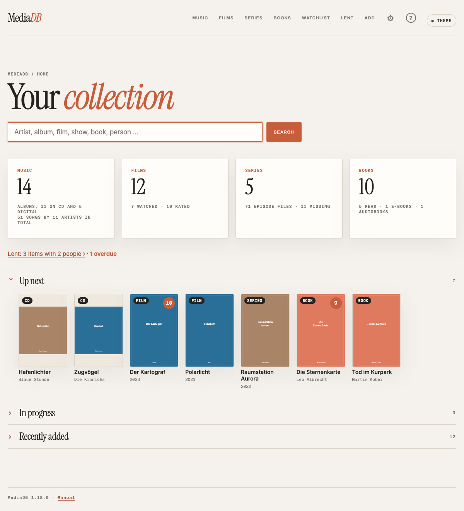

**Search:** the search box on the home page finds music (including song titles), films, TV shows, books, people and authors, and also names under “Lent to”. Each section also has its own search with filters.

**Up next:** every CD, film, show and book page has **“☆ Mark as up next”** for what you want to listen to, watch or read next; a second click removes it. Each section has its own “Up next” tab, and a ★ marks these entries in all lists. The list tidies itself up: a film disappears as soon as you mark it as watched, a book once it is read, a show once no aired episode is left unwatched. CDs you remove yourself.

**Tiles, list or text:** at the top right above every list you choose the view: **tiles** (cover grid), **list** (one slim row per entry with a small picture, so much more fits on the page) or **text** (no pictures at all). The browser remembers your choice for each section.

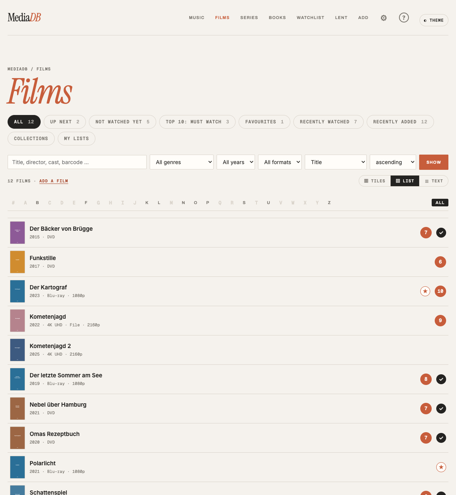

**Background tasks:** when something runs in the background (import, loading covers, update), the top bar shows “1 task running” with a dot. A click shows exactly what is running, with progress. **Orange** means it is reading your files, **green** that it is only loading data from the internet. You can keep working meanwhile.

**Dry run before saving:** all imports (spreadsheets, folders, ISBN lists) first show a **preview** with the groups “Recognised”, “Please check”, “Not found” and “Already present”. Nothing is saved until you click **Apply**. The buttons sit in a bar that stays at the bottom while scrolling, e.g. “Please check: first suggestion everywhere”. Importing again is safe: files already recorded are skipped.

**New version:** when a new version is available, “New version … available” appears at the bottom next to the version number, with a link to what’s new. How to install it is described in section 13.

## 5. Music

**Adding** (Add):
- **Barcode:** scanner or typing. MusicBrainz is searched for matching releases (official ones first, then the oldest; bootlegs collapsed). Incomplete barcodes (10/11 digits) are completed, dashes and spaces ignored. Choose a result → “Save this result”. Cover and tracks come along.
- **Discography search without a scanner:** choose an artist, then all of their CDs as a list (with A–Z bar and barcode), pick the release, “This is my CD”.
- **Import a spreadsheet (Excel, ODS, CSV):** upload the file → check the columns (artist, title, barcode, year) → compare. Artist and album title are enough; the app fetches the rest from MusicBrainz (about one row per second). Existing entries are skipped, anything not found is created as a simple entry.
- **Audio import:** choose a music folder → read. The folder can be on an external drive, on the NAS or on a Mac (section 12). Rules:
  - One folder is one album; several formats of the same album (MP3 + M4A) stay one entry; disc folders are merged.
  - Matching uses the **track list**: identical tracks = the same CD (then only “+ digital” and the format are noted); different tracks (remaster with bonus tracks) = a separate entry.
  - The app recognises compilations by tracks from different artists.
- **By hand:** all fields can be filled in freely, including the track list.

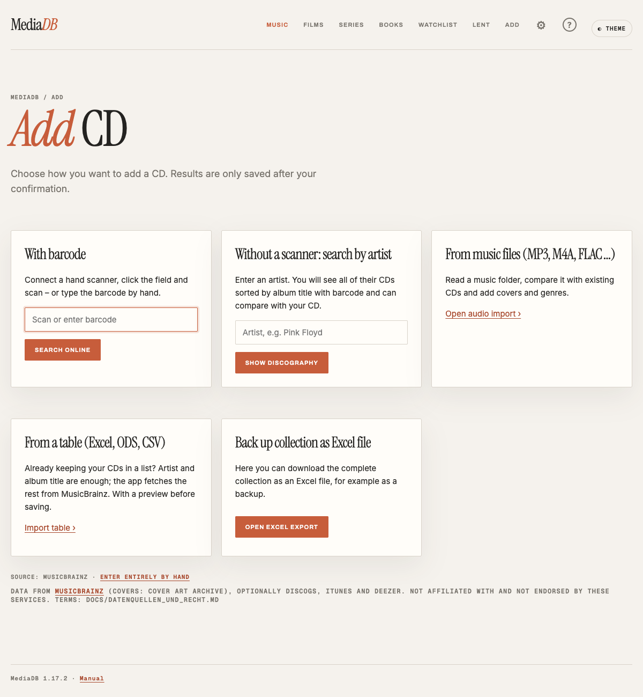

**Browsing:** under **Music** you find the **artists** with an A–Z bar (a click shows their CDs, or the entry itself if there is only one) and the tab **All CDs**. Each entry shows cover, track list with durations, label, catalogue number, country, year of the CD **and** the album’s release date, genre and styles, **ownership** (CD, digital only, CD + digital) and file formats. **Compilations** are one entry (“Various Artists”) and are also found via the artists of the individual tracks. The search finds artist, album, genre, label, song titles and notes; several words must all match.

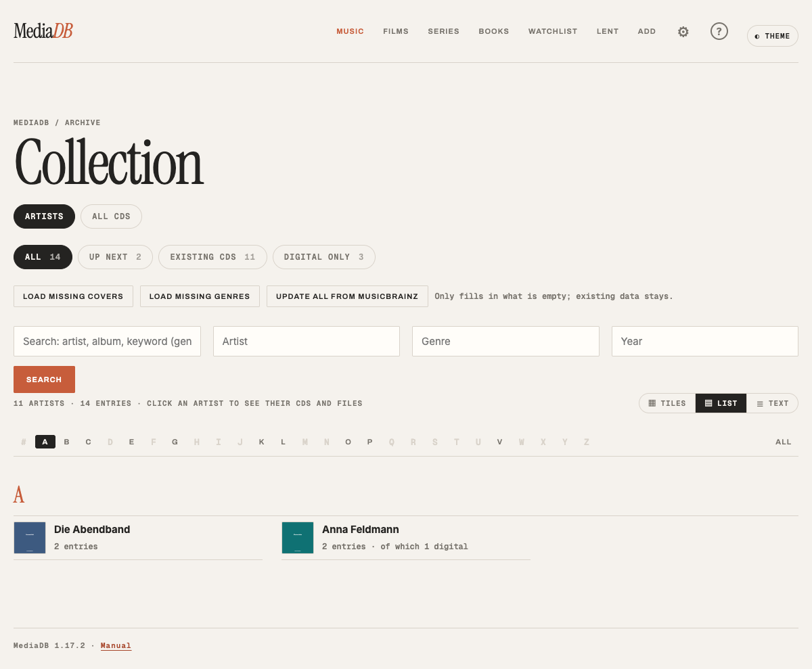

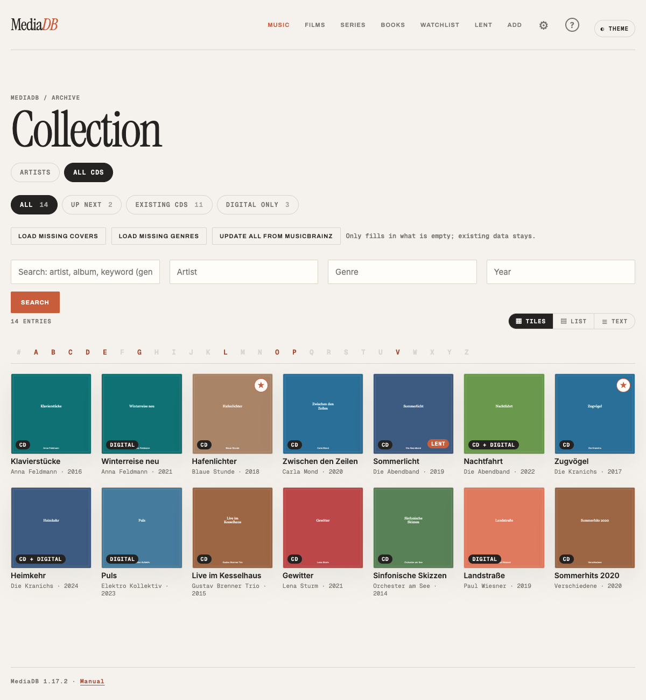

**Bulk actions** with progress display: **Load missing covers**, **Load missing genres**, **Update all from MusicBrainz** (only fills in empty fields, overwrites nothing).

**Missing cover or data:** open the entry → **“Find similar release”** → choose a result, or paste the link of a **Discogs** release page (preview, then confirm; empty fields, track list and cover are taken over). As a last resort, put a `cover.jpg` file into the music folder.

## 6. Films

**Requirement:** a TMDB key (settings, section 3).

**Adding** (Films → Add):
- **Barcode:** scan, choose the format or let it be detected. The app looks up the product name (“The Godfather [Blu-ray] Steelbook” becomes “The Godfather”) and shows matching films from TMDB. Choose a result, enter an edition if you like (a list with suggestions such as Director’s Cut or Steelbook; free text works too), “This is my film”. If the barcode is already in your collection, the app doesn’t search but clearly shows **“Already in the archive”** with “Go to film” and “Search anyway”. Results you already have are marked too. After saving, **“Add another film”** takes you straight to the next one.
- **Title search:** title and optionally the year.
- **Folder import:** choose a folder → read and recognise → check the preview → Apply. Most reliable are Jellyfin/Kodi `.nfo` files or names like `Title (Year)/Title (Year).mkv` or `Title (Year) [tmdbid-123]`. Scene names like `Title.2010.German.1080p.BluRay` are cleaned up. Trailers, samples and extras are skipped; DVD/Blu-ray folders (VIDEO_TS, BDMV) count as one film. From the files the app reads resolution, HDR, codec, runtime, audio tracks and subtitles. **Better resolution:** if the film already exists as a file in another resolution, the preview shows both and asks: take the new file and remove the old file’s entry, keep both, or skip. If the new one is better (e.g. 2160p instead of 1080p) or the old one is gone, “take the new file” is preselected. MediaDB never deletes the old file itself; you do that on the NAS. TV shows work the same way, episode by episode.
- **By hand:** for films TMDB doesn’t know.

**One film, several copies:** if you have “Alien” on DVD, Blu-ray and as a file, that is one film with three copies. Add another copy on the film’s page or by scanning the barcode of the second disc.

**Watched and rating:** “Watched today” or enter a date; the year alone is enough (e.g. 1999). Empty means “unknown”. “Watched again today” counts up. Your own rating goes from 1 (delete 5×) to 10 (must watch); for unwatched films it says how urgently you want to see it.

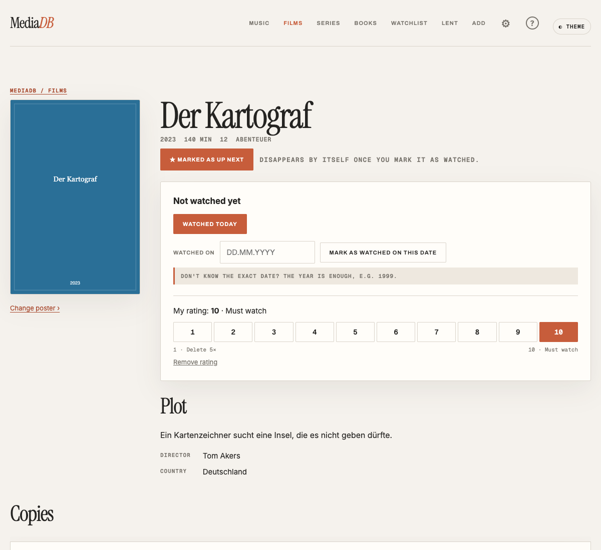

**Lists:** All · Up next · Not watched yet · Top 10: must watch (the 10 unwatched films with the highest rating) · Favourites (watched, 9–10) · Recently watched · Recently added · Collections (from TMDB) · My lists (create under “My lists” or on the film page). The search finds title, original title, director, cast, keywords and barcodes; there are also filters for genre, decade and format and an A–Z bar (“The Godfather” is under G).

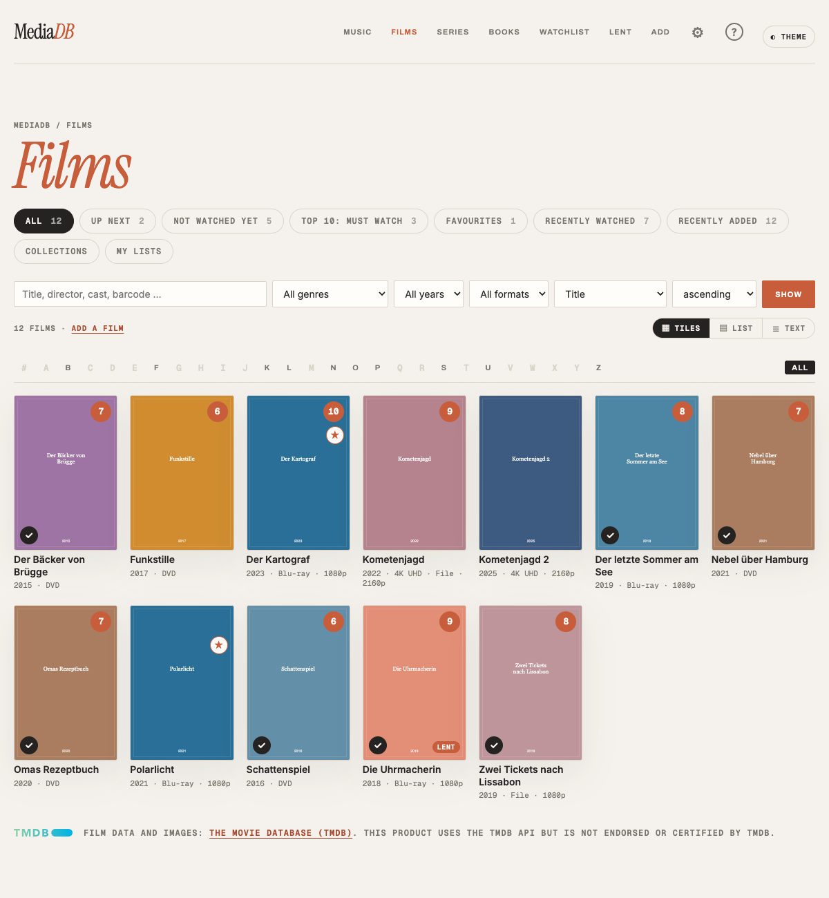

**Posters:** in the film overview **“Load missing posters”**. The app first looks for pictures next to the video file (`poster.jpg`, `folder.jpg`, `cover.jpg` …), then for covers embedded in the file, then for all posters on TMDB. For a single film: **“Change poster”** on the film page (choose a TMDB poster or upload your own picture, e.g. a scan of the case).

**People:** names in cast, director and screenplay can be clicked. The person page shows photo and short biography, all films and shows with this person in your collection and, below, more according to TMDB, each with “Add”.

**Wrong match?** **“Match a different film”** on the film page. Copies, watched, rating, lists and note are kept. If a film shows a completely wrong poster, it is usually matched wrongly.

## 7. TV shows

**Requirement:** the same TMDB key as for films.

**Adding** (Series → Add):
- **Barcode of a box set:** the app searches via the product name. If it says e.g. “Season 1-3” or “The complete series”, that is suggested as the box set’s content.
- **Title search:** title and optionally the year of first broadcast. Entering a box set is optional.
- **Folder import:** choose the folder that contains the show folders → read and recognise → check the preview → Apply. Episodes are grouped by show, and each show is looked up once on TMDB. Recognised are `Show.S01E01`, `S01E02E03` (double episode), `1x01`, `E01` without a season and season folders like `Season 1` or `Staffel 1`. A `tvshow.nfo` from Jellyfin or Kodi makes the match certain. New episodes are simply added on the next run.
- **By hand:** for shows TMDB doesn’t know (then without an episode guide).

**Episode guide:** for each show the app loads all seasons and episodes with title, plot and air date. Episode names come from there even if the file name has none; if a title is missing in the data language, the English one is used. **“Update episode guide”** fetches new episodes.

**What’s missing?** On the show page every episode is marked “present” (with resolution or “box”), “missing” or “upcoming”. The page **What’s missing?** lists all shows with gaps, also **as text to copy**. Only aired episodes count, specials (season 0) don’t.

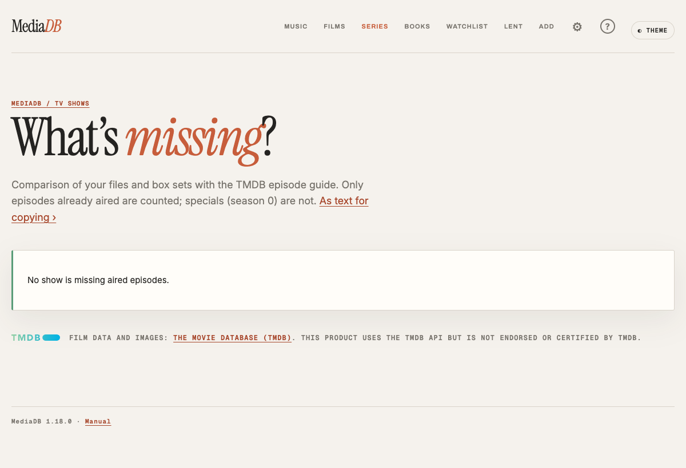

**Watched and rating:** a tick per episode, “Mark whole season as watched”, or at the top under **“Continue with:”** (the next unwatched episode) click “Watched”. The rating 1–10 works like for films.

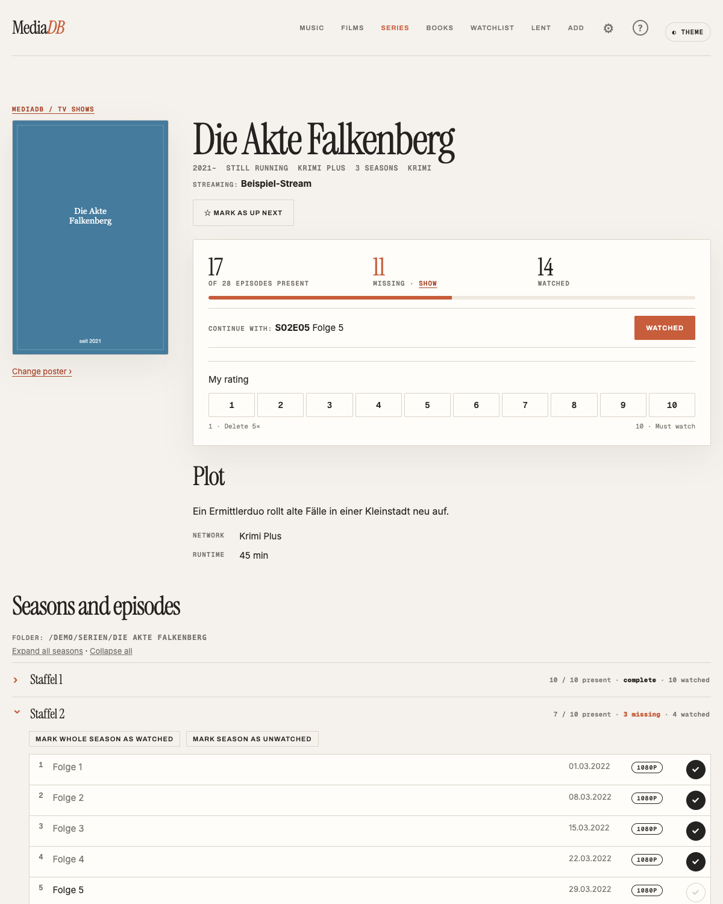

**Overview:** All · Up next · Incomplete · Started · Not started · Fully watched · Still running · Recently added · What’s missing?, plus a filter by streaming service. The search finds title, cast, network and barcodes.

**Streaming service:** the show page shows which subscription service carries the show (according to JustWatch via TMDB), with “Where to watch?” and the date of the next episode. If that is wrong, enter your own under “Edit”.

**Corrections:** files that couldn’t be matched to an episode are listed at the bottom of the show page; enter season and episode by hand there. Wrong show recognised: **“Assign another show”** (files, box sets and watched status are kept).

## 8. Watchlist

Menu **Watchlist**:
- **New for your shows:** what starts soon (e.g. “Season 4 starts on 16.10.” with the service), what was released in the last 30 days and which seasons are announced.
- **On the list:** search films and shows, **“Add to list”**, add a note (e.g. “tip from …”). The app shows the cinema, digital or season release, the streaming service and whether the title is already in your collection. “Add to collection” leads to the right section, “done” takes the entry off the list (restorable under “Done entries”).
- **In a media library now:** noted titles currently available from ARD, ZDF and others.

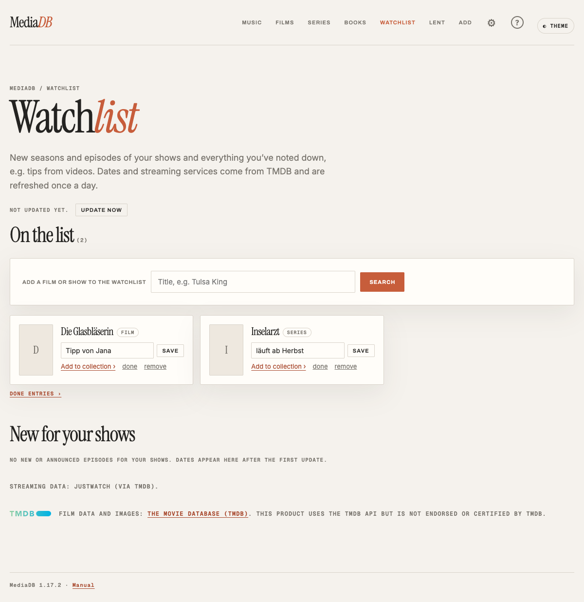

**Updates:** once a day the app refreshes in the background: running shows daily, ended ones every 30 days, plus the watchlist. **“Update now”** starts it right away.

Watchlist or up next? The **watchlist** is for titles you **don’t** own yet. **Up next** (section 4) is for entries from your collection.

## 9. Books

No key is needed.

**Adding** (Books → Add):
- **With ISBN:** scan the barcode or type the ISBN (10 or 13 digits). The app asks the **German National Library** and **Open Library** and shows the edition for confirmation. If the ISBN is already in your collection, it shows the existing book.
- **By title and author:** enter the title and preferably the surname, then choose the right edition.
- **By hand:** for books no database knows.
- **Many books at once** (book import): an **ISBN list** (one ISBN per line, e.g. scanned one after another into a text file) or a **CSV or Excel spreadsheet** with columns like ISBN, title, author, format, read, rating, note. About one second per book; the status display at the top shows the progress.
- **E-books and audiobooks from folders:** EPUB, PDF, MOBI/AZW3, Calibre libraries (details from `metadata.opf`), M4B files and folders of MP3/M4A (one folder = one audiobook, also with subfolders “CD 1”, “CD 2”). For audiobooks choose only the audiobook folder, not your music collection.

**Copies:** hardcover, paperback, e-book, audiobook or other; a book can have several.

**Reading and rating:** “Currently reading”, “Read” with a date (or just the year), rating 1–10, note.

**Overview:** sortable by author (surname), title (ignoring leading articles), year, rating and date added, with A–Z bar and filters for genre, format and language. Views: Up next, Unread, Currently reading, Read, Favourite books, Recently read, Recently added, E-books, Audiobooks.

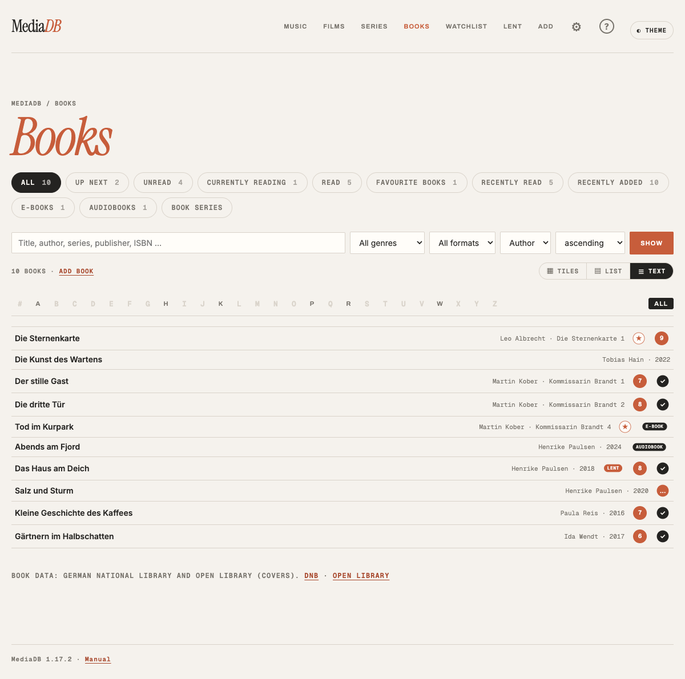

**Authors and series:** author names can be clicked. Under **Book series** you find all series with volume numbers; missing volumes are named.

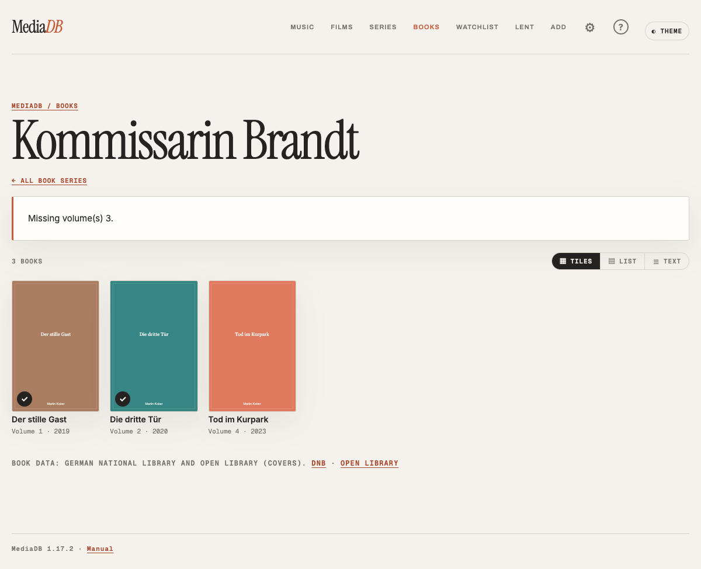

**Summary and ratings:** under “Contents” the publisher’s text (via the National Library) or the description from Open Library, below it the introduction of the **Wikipedia** article if there is one, and the **rating on Open Library**. “Find reviews” opens a search on Perlentaucher, Goodreads or the web. If the Wikipedia article doesn’t fit, click “Remove”.

**Corrections:** “Edit” for all details, “Fill in empty fields” (overwrites nothing), “Assign another book” for a wrong match, “Change cover” for a different cover or your own photo.

**Good to know:** at the National Library the series is often just the publisher’s series (“dtv 21412”); the app doesn’t take those over, you can enter the series yourself under “Edit”. Not every German edition has a cover; a photo of the cover helps then.

## 10. Lent to …

For all sections together there is the page **Lent** (menu), with its own small database (`data/verleih.db`).

**What can be lent:** only things you can hold in your hand: CDs (ownership “CD” or “CD + digital”), DVDs, Blu-rays and 4K discs, TV box sets, printed books and audiobook CDs. Files and e-books show “Digital only”.

**Lending:** at the bottom of a CD, film, show or book page open “Lend …”, enter the name (known names are suggested), check the date (today is pre-filled; leave it empty or enter just the year if you no longer know) and “Mark as lent”. “Due back” and a note are optional. With several copies you choose which one.

**Adding many old loans:** on the “Lent” page enter the name at the top and search by title, artist or author. Every result has “Lend to …”.

**Getting things back:** on the detail page, in the overview or on the person’s page; there is also “Got everything back”. An entry made by mistake can be deleted.

**Overview:** everything sorted by person, with a filter by section; overdue returns are red. **“As text to copy”** gives you the list, e.g. for a message. Lent entries are marked in all overviews.

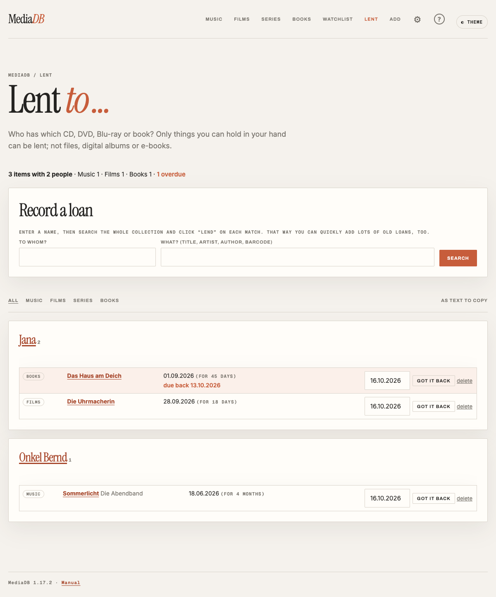

## 11. Media libraries

Every show and film page has **In the media library**: results from the media libraries of the public broadcasters (ARD, ZDF, Arte, 3sat, ORF, SRF and others) with channel, air date, length and link. The search runs after the page has loaded and usually takes a second or two.

**For TV shows** the results are matched to the episode guide and marked **“you’re missing it”** or “present”. So you see immediately whether a missing episode is currently available somewhere.

**Good to know:** programmes are only available for a limited time, some only in certain countries. MediaDB only shows links and downloads nothing. It can be switched off under Settings → “Services and automation”.

## 12. Files from a NAS or Mac

MediaDB reads music, films, TV shows and books **directly from your NAS** (SMB, as in Finder or Windows Explorer) without mounting anything, also inside a Proxmox LXC. It only reads.

1. **Settings → NAS shares → Add share:** name (e.g. “Music”), the NAS’s **IP address** (e.g. `192.168.1.20`; names like `nas.local` usually can’t be resolved inside the container), share, optionally a subfolder, user and password. Pasting the whole address `smb://192.168.1.20/Music/Albums` into the NAS address field works too.
2. **“Test connection”** tests without saving and tells you what is wrong (name not found, NAS not answering, SMB off, sign-in, share or subfolder wrong). Then **“Save and test”**.
3. For further shares on the same NAS choose **“Reuse the login of a NAS already set up”**.
4. When importing, the share appears in the folder picker as **“NAS: Music”**.

**A NAS that isn’t always on:** next to every NAS, the settings and the folder picker show a dot: **green “reachable”** or **orange “off right now”**. What has been imported stays in MediaDB even when the NAS is off. If it goes off during an import, MediaDB lists the missing folders afterwards; simply import again later.

**Music from a Mac:** share the music folder on the Mac via file sharing (SMB) and add it to MediaDB like a NAS. The important part is the tick for **Windows File Sharing** for your user. The steps are in [BETRIEB.md → Musik vom Mac](BETRIEB.md#musik-vom-mac-oder-einem-anderen-rechner-einlesen) (German). A Windows PC works the same way.

More help with problems: [BETRIEB.md → Musik und Filme von der NAS einlesen](BETRIEB.md#musik-und-filme-von-der-nas-einlesen-ab-1-9) (German).

## 13. Backups and updates

**Your data** lives in the folder `data/` (in a homelab `/opt/mediadb/data`): the databases `musik.db`, `filme.db`, `serien.db`, `buecher.db` and `verleih.db`, the settings `settings.json`, the covers and pictures. **Back up this folder** and never overwrite it during updates. How to back up in the LXC is described in [BETRIEB.md → Sicherung](BETRIEB.md#sicherung) (German).

**Export** (Add in the music section → “Open Excel export”): xlsx (Excel), ods (LibreOffice), csv (semicolon, UTF-8) or Markdown; everything, only CDs or only digital. The Excel file contains all fields including track lists and can be imported again. The export only covers music; for a complete backup always copy the `data` folder.

**Installing a new version:**
- **Homelab with Dockhand:** stack “mediadb” → **Pull** → **Redeploy**. Your data is kept.
- **Mac with the project folder:** copy the new files over the project (don’t touch `data/` and `.env`), then `docker compose up --build -d` and Cmd+Shift+R in the browser.

Afterwards the new version number is shown at the bottom. What has changed is listed in [CHANGELOG.md](../CHANGELOG.md) (German) and in the [releases on GitHub](https://github.com/luro611/mediadb/releases).

## 14. Where does the data come from?

Music: **MusicBrainz** with the **Cover Art Archive**, optionally **Discogs**, **iTunes** and **Deezer** as fallback sources for covers, plus the tags in your music files. Films and TV shows: **TMDB** (data, episode guides, pictures; streaming services from JustWatch via TMDB), DVD/Blu-ray barcodes: **UPCitemdb**. Books: **German National Library**, **Open Library** and **Wikipedia**. Media libraries: **MediathekViewWeb**. New versions: the public release list on **GitHub**. Only search terms are sent; your collection stays with you. More details, including “Am I allowed to do this?”, are in [DATENQUELLEN_UND_RECHT.md](DATENQUELLEN_UND_RECHT.md) (German).

## 15. Limitations

- No separate accounts: one shared password (optional); “watched”, “read” and ratings apply to the whole household. Don’t put it on the open internet.
- The free barcode service only partly knows German DVD and Blu-ray editions. The title search helps then; the barcode is saved anyway.
- Deleted or moved files are not cleaned up automatically.
- NAS and Mac: only SMB2/SMB3 with user and password, no guest access.
- Covers from iTunes/Deezer are a legal grey area and can be switched off.
- Very old, rare or only locally released albums are sometimes missing on MusicBrainz; Discogs or adding by hand helps then.
- Hobby project without warranty; please report errors with the version number and, if possible, the log.

## 16. Troubleshooting

| Problem | Solution |
|---|---|
| Page not reachable | Homelab: check in Dockhand that the stack is running and look at the container logs. Mac: `docker compose ps`, `docker compose up -d`, if needed `docker compose logs --tail 60`. |
| Container restarts in a loop | Read the first line with `Traceback` in the log and report it with the version number. |
| New version not running despite Pull and Redeploy | Check the version number at the bottom of the page; in Dockhand do **Pull** again (not just Redeploy), then Redeploy. |
| No note about a new version | Settings → “New version?” → “Check for a new version now”. |
| NAS: “Test connection” reports an error | The message says what is wrong; a technical detail is shown below. Enter the IP instead of a name, check user and password. See section 12. |
| NAS shows “off right now” | Switch the NAS on, wait a minute or two, reload the page. |
| After an import: “Folders that couldn’t be read” | The NAS was off in the meantime or the user may not read those folders. Import again later. |
| Music folder on the Mac empty or “access denied” | Allow macOS access for OrbStack/Docker (section 2). |
| MusicBrainz doesn’t answer | Try again later; the app keeps to 1 request per second. Is the e-mail address entered in the settings? |
| Films or shows: “No TMDB key” | Enter the key in the settings and use “Check TMDB key”. |
| Barcode finds nothing | Check that it is complete (12/13 digits), otherwise use the title search or “Find similar release”. |
| A folder on the NAS can’t be renamed | Check at the top whether a task “reading files” is running (orange). It works again afterwards. |
| Cover not found | See section 5, “Missing cover or data”. |
